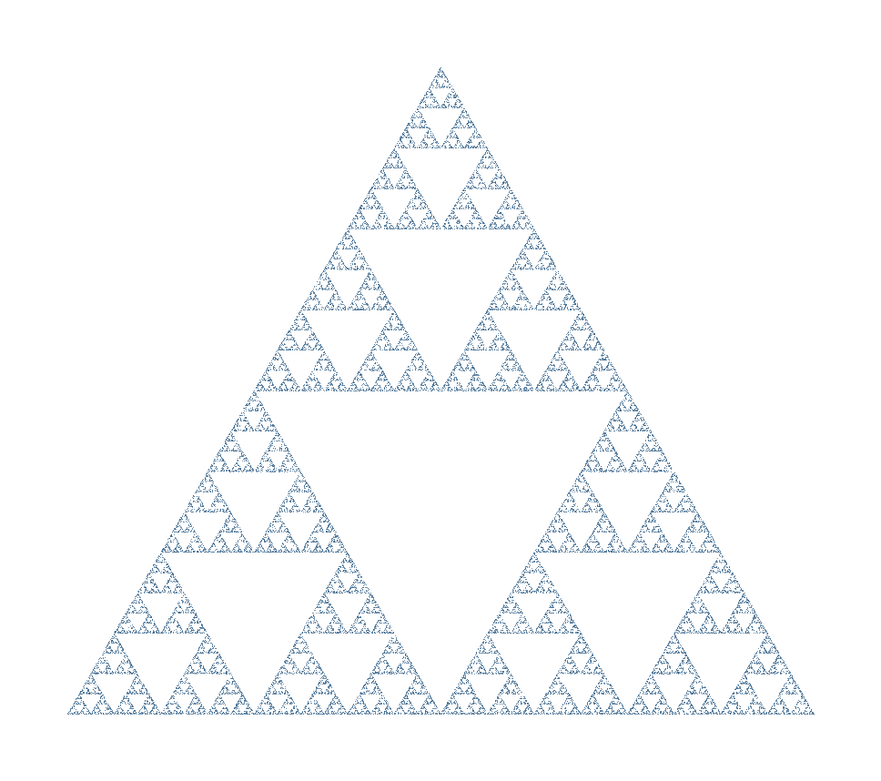

# Espaces métriques {#chap:metriques}

La notion de distance est rencontrée dès l'école primaire, lorsqu'on
mesure l'écart entre deux points, entre deux villes sur une carte ou
entre deux nombres sur une droite graduée. Ces situations font appel
à une même intuition : une petite distance correspond à des objets
proches, et la distance ne dépend pas de l'ordre dans lequel on les
nomme. Cependant, comment définir cette notion sur un ensemble dont
les éléments ne sont pas des points du plan? Peut-on, par exemple,
parler d'une distance entre deux villes sur une sphère, entre deux
mots de même longueur ou entre deux figures géométriques?

Pour répondre à ces questions, nous allons dégager quelques propriétés
de la distance euclidienne et les utiliser pour définir les
[espaces métriques]{.defi}. Une fonction qui satisfait ces propriétés
sur un ensemble quelconque permet d'y introduire les notions de
voisinage, de convergence et de continuité. Nous pourrons même définir
une distance entre des *ensembles*, comme nous le ferons à la
section \ref{sec:hausdorff}.

::: {#fig:sierpinski}
{width=62%}

Le *triangle de Sierpiński*, obtenu par un procédé aléatoire simple (le « jeu du chaos ») : partant d'un point, on choisit au hasard, à répétition, l'un des trois sommets d'un triangle, et on avance à mi-chemin vers lui. L'existence et l'unicité de l'ensemble fractal associé à cette construction seront justifiées au chapitre \ref{chap:fractales}, à l'aide du théorème du point fixe de Banach (théorème \ref{thm:banach}, section \ref{sec:banach}), que nous démontrerons dans les pages qui suivent. Un tel ensemble fractal sera défini comme un point d'un espace dont les « points » sont eux-mêmes des ensembles compacts du plan, muni précisément de la distance de Hausdorff définie à la section \ref{sec:hausdorff}. Cette application explique l'intérêt d'introduire une distance entre des ensembles.
:::

Nous commencerons par la définition d'un espace métrique et par des exemples
issus de la géométrie et de deux applications : la navigation sur une sphère,
et la détection d'erreurs
dans une chaîne de bits. Nous introduirons ensuite les notions
d'ensemble ouvert, fermé et compact, ce qui nous permettra de définir
la distance de Hausdorff entre ensembles compacts. Nous terminerons par
la notion de point fixe et par le théorème de Banach, qui établit, sous
certaines hypothèses, l'existence et l'unicité d'un
point fixe. Ce résultat est utilisé notamment dans les méthodes numériques,
l'analyse ou la géométrie des
fractales, objet du chapitre \ref{chap:fractales}.

## Qu'est-ce qu'une distance ? {#sec:def-metrique}

Commençons par rappeler les propriétés de la distance euclidienne
dans le plan. Si $P$, $Q$ et $R$ sont trois points du
plan, et si $d(P,Q)$ désigne la distance entre $P$ et $Q$ :

\par

1. $d(P,Q)$ est toujours un nombre positif ou nul ;
2. $d(P,Q) = 0$ exactement quand $P$ et $Q$ sont le même point ;
3. $d(P,Q) = d(Q,P)$, c'est-à-dire que la distance de $P$ à $Q$ est
   la même que celle de $Q$ à $P$ ;
4. $d(P,Q) \leq d(P,R) + d(R,Q)$, c'est-à-dire qu'un détour par un
   troisième point $R$ n'est jamais plus court que le chemin
   direct.

\par

Ces quatre propriétés ne font intervenir ni les coordonnées, ni le
fait que $P$, $Q$ et $R$ soient des points du plan. Nous pouvons donc les
reprendre pour définir une distance sur un
ensemble quelconque.

::: {.definition #def:metrique title="Métrique, espace métrique"}
Soit $E$ un ensemble. On appelle [métrique]{.defi} (ou [distance]{.defi})
sur $E$ une fonction
$$
  d : E \times E \to \R
$$
telle que, pour tout $x, y, z \in E$ :

(a) $d(x,y) \geq 0$ \hfill (positivité)
(b) $d(x,y) = 0 \iff x = y$ \hfill (séparation)
(c) $d(x,y) = d(y,x)$ \hfill (symétrie)
(d) $d(x,y) \leq d(x,z) + d(z,y)$ \hfill (inégalité triangulaire)

Le couple $(E, d)$ s'appelle alors un [espace métrique]{.defi}.
:::

L'expression « inégalité triangulaire » vient du cas $E = \R^2$.
Dans un triangle de sommets $x$, $y$, $z$, la longueur de chaque côté
est inférieure ou égale à la somme des longueurs des deux autres.
La propriété étudiée au secondaire se retrouve donc ici dans une
définition qui s'applique à des ensembles beaucoup plus généraux.

::: {#fig:triangle-inegalite}

L'inégalité triangulaire : la distance directe $d(x,y)$ est inférieure ou égale à la somme $d(x,z) + d(z,y)$, quel que soit le point $z$ utilisé pour faire un détour.
:::

::: {.remark #rem:distance-nulle title="La propriété de séparation"}
La condition (b) réunit deux implications qu'il faut distinguer. D'une part,
$d(x,x) = 0$ pour tout $x$ : la distance d'un
point à lui-même est nulle, conformément à l'intuition habituelle. D'autre part, *seuls* deux points
confondus sont à distance nulle : si $d(x,y) = 0$, alors nécessairement
$x = y$. Cette propriété porte le nom de [propriété de
séparation]{.defi}, parce qu'elle garantit qu'une métrique *sépare*
toujours les points distincts par une distance strictement positive.
Nous verrons à la section \ref{sec:hausdorff} un exemple où cette
condition devra être vérifiée avec attention.
:::

### Les distances euclidienne et de Manhattan {#sec:exemples-classiques}

::: {.example #ex:distance-euclidienne title="La distance euclidienne dans $\R$ et $\R^n$"}
Sur $\R$, la fonction $\dE(x,y) = |x - y|$ est une métrique : on vérifie les
trois premières conditions à l'aide des propriétés élémentaires de la
valeur absolue; l'inégalité triangulaire découle de
$|a + b| \leq |a| + |b|$, appliquée à $a = x - z$ et $b = z - y$.

Plus généralement, si $X = (x_1, \dots, x_n)$ et $Y = (y_1, \dots,
y_n)$ sont deux éléments de $\R^n$, la fonction
$$
  \dE(X, Y) = \sqrt{\sum_{i=1}^{n} (x_i - y_i)^2}
$$
est une métrique sur $\R^n$, appelée [distance euclidienne]{.defi}. Cette
métrique correspond à la notion usuelle de distance : pour $n = 2$, on
retrouve le théorème de Pythagore appliqué à la différence des
coordonnées. Sauf mention contraire, c'est cette métrique que nous
utiliserons sur $\R^n$.
:::

::: {.example #ex:taxi title="La taxi-distance"}
Notons $X = (x_1, y_1)$ et $Y = (x_2, y_2)$ deux points de $\R^2$. La
fonction
$$
  \dT(X, Y) = |x_2 - x_1| + |y_2 - y_1|
$$
définit une autre métrique sur $\R^2$ (on vérifie l'inégalité
triangulaire en l'appliquant séparément à chaque coordonnée, comme à
l'exemple \ref{ex:distance-euclidienne}). On l'appelle [taxi-distance]{.defi},
ou [distance de Manhattan]{.defi} : c'est la distance que devrait
parcourir un taxi contraint de rouler sur un quadrillage de rues
perpendiculaires, sans pouvoir emprunter de trajet diagonal.
:::

::: {#fig:taxi}

Comparaison de deux distances entre les points $A$ et $B$. Le segment bleu correspond à la distance euclidienne $\dE(A,B)$ ; l'escalier rouge, à la taxi-distance $\dT(A,B)$, soit la longueur totale des déplacements horizontaux et verticaux, quel que soit le chemin en escalier choisi entre $A$ et $B$.
:::

::: {.remark #rem:deux-metriques title="La même paire de points, deux distances différentes"}
La figure \ref{fig:taxi} permet de faire une distinction : $\dE$ et $\dT$
sont deux métriques *distinctes* définies sur le *même*
ensemble $\R^2$. En général, $\dE(X,Y) \neq \dT(X,Y)$ : dans l'exemple
de la figure, $\sqrt{34} \approx \num{5.83}$ contre $8$. Un ensemble muni de
deux métriques différentes donne lieu à deux espaces métriques
différents, $(\R^2, \dE)$ et $(\R^2, \dT)$, bien qu'ils aient les mêmes
éléments. Nous reverrons ce phénomène à la
section \ref{sec:ouverts-fermes} : la forme d'une boule ouverte dépend
de la métrique choisie, pas seulement de l'ensemble sur lequel elle est
définie.
:::

### Une métrique appliquée : la distance sur la sphère {#sec:sphere}

Les distances précédentes ont été définies dans le plan. Lorsqu'on
s'intéresse à un déplacement sur une surface courbe, la distance
mesurée dans l'espace ambiant ne correspond pas nécessairement au
trajet possible. Par exemple, le segment qui joint Montréal à Paris
passe à l'intérieur de la Terre; un avion ne peut pas le suivre.
Il faut donc considérer une distance mesurée *le long de la
sphère*.

Pour deux points d'une sphère, la distance entre $u$ et $v$ se mesure le long
de l'arc de [grand cercle]{.defi} qui les joint, où
le grand cercle est l'intersection de la sphère avec le plan passant
par $u$, $v$ et le centre $O$ (figure \ref{fig:sphere}) : cet arc décrit le
plus court chemin *le long de la surface*. On appelle cette
longueur d'arc la [distance sphérique]{.defi}, ou distance du grand
cercle, entre $u$ et $v$. Une définition rigoureuse de cette distance,
à l'aide des coordonnées de $u$ et $v$, ainsi que les calculs qui
l'accompagnent, relèvent d'une étude plus détaillée consacrée aux systèmes de positionnement et aux
coordonnées sphériques.

::: {#fig:sphere}

La distance sphérique entre $u$ et $v$ se mesure le long de l'arc de grand cercle (en bleu), qui passe au-dessus de la corde (en rouge, pointillé) : cette corde traverse l'intérieur de la sphère, et ne représente donc pas un trajet sur sa surface. Cette distinction intervient dans la navigation aérienne et les systèmes GPS. Elle permet notamment de comprendre pourquoi les vols transatlantiques vers l'Europe empruntent une route qui semble courber vers le nord sur une carte plane.
:::

### Une métrique appliquée : mesurer les erreurs {#sec:hamming}

Un autre exemple vient des communications numériques. Lorsqu'un
message est transmis sous forme binaire, certains bits, soit des $0$
ou des $1$, peuvent être inversés sous l'effet du bruit. Cela peut se
produire dans un canal informatique, lors de la lecture d'un disque
compact ou dans une transmission par satellite. Pour détecter ces
erreurs et, si possible, les corriger, nous devons d'abord préciser
comment *mesurer* la différence entre deux messages.

::: {.definition #def:hamming title="Distance de Hamming"}
Soit $n \in \Ns$, et soit $\{0,1\}^n$ l'ensemble des suites de $n$
bits. Pour $X = (x_1, \dots, x_n)$ et $Y = (y_1, \dots, y_n)$ dans
$\{0,1\}^n$, on pose
$$
  \dHam(X,Y) = \sum_{i=1}^{n} |x_i - y_i|.
$$
On appelle $\dHam$ la [distance de Hamming]{.defi} sur $\{0,1\}^n$.
:::

Puisque $x_i, y_i \in \{0,1\}$, le terme $|x_i - y_i|$ vaut $1$ si les
deux bits diffèrent à la position $i$, et $0$ sinon. Ainsi,
$\dHam(X,Y)$ donne ainsi le [nombre de positions où $X$ et
$Y$ diffèrent]{.defi}, c'est-à-dire le nombre minimal de bits qu'il faut
inverser pour transformer $X$ en $Y$.

::: {.example #ex:hamming-calcul title="Un calcul de distance de Hamming"}
Soit $X = (1,0,0,1)$ et $Y = (1,1,0,0)$ deux suites de $\{0,1\}^4$.
Alors
$$
  \dHam(X,Y) = |1-1| + |0-1| + |0-0| + |1-0| = 0+1+0+1 = 2.
$$
Les suites $X$ et $Y$ diffèrent donc à exactement deux positions, la
deuxième et la quatrième, comme on peut aussi le vérifier en comparant les termes :
$$
  X = (1,\underline{0},0,\underline{1}), \qquad
  Y = (1,\underline{1},0,\underline{0}).
$$
:::

Les trois premières conditions de la définition \ref{def:metrique} se
vérifient à partir de la somme : une somme de valeurs absolues est positive ou
nulle, elle
est nulle exactement quand chaque terme l'est (c'est-à-dire quand
$X = Y$), et $|x_i - y_i| = |y_i - x_i|$ donne la symétrie. Pour
l'inégalité triangulaire, il suffit d'observer que si $X$ et $Z$
diffèrent à la position $i$, ou si $Z$ et $Y$ diffèrent à la position
$i$ (ou les deux), alors $X$ et $Y$ peuvent différer à cette position,
mais pas plus : $\dHam(X,Y) \leq \dHam(X,Z) + \dHam(Z,Y)$, une position
où $X$ et $Y$ diffèrent alors que $X$ et $Z$ n'y diffèrent pas
forçant nécessairement $Z$ et $Y$ à y différer.

::: {.historical #hist:hamming title="Richard Hamming et la détection d'erreurs"}
La distance qui porte son nom a été introduite en 1950 par l'ingénieur
et mathématicien états-unien Richard Hamming (1915--1998), qui
travaillait alors aux laboratoires Bell sur la fiabilité des premiers
ordinateurs à relais. Les arrêts de la machine durant les fins de semaine
l'irritaient : celle-ci détectait une erreur de lecture, mais ne pouvait pas
la corriger. Hamming s'est donc demandé comment construire un code qui
permettrait aussi d'identifier *l'erreur* à corriger. Sa solution, les
codes de Hamming, consiste à choisir les messages valides de façon qu'ils
soient tous à
une distance de Hamming d'au moins $3$ les uns des autres : un message
corrompu par une seule erreur de bit reste alors strictement plus
proche (au sens de $\dHam$) du message original que de tout autre
message valide, ce qui permet de la corriger automatiquement. On
retrouve aujourd'hui cette même idée, sous une forme ou une autre, dans
les CD, les disques durs et les communications par satellite.
:::

## Ouverts, fermés et compacts {#sec:ouverts-fermes}

Avant de définir une distance entre deux *ensembles*, nous allons
introduire les notions d'ensemble ouvert, fermé et compact. Elles
s'appuient sur celle de boule ouverte et s'expriment dans le langage
des espaces métriques. Nous les illustrerons principalement dans
$\R^n$, où il est plus facile de leur donner une interprétation
géométrique.

### Boules et ensembles ouverts

::: {.definition #def:boule title="Boule ouverte"}
Soit $(E,d)$ un espace métrique, soit $x_0 \in E$ et soit $r > 0$. On
appelle [boule ouverte]{.defi} de centre $x_0$ et de rayon $r$ l'ensemble
$$
  \boule{x_0}{r} = \{x \in E : d(x,x_0) < r\}.
$$
:::

::: {#fig:boules}

L'allure d'une boule ouverte dépend de la métrique, même lorsque l'ensemble et le point $x_0$ sont les mêmes : un disque pour $\dE$ (à gauche), un carré tourné de $45^\circ$ pour $\dT$ (à droite, car $|x-x_0|+|y-y_0|<r$ décrit précisément l'intérieur d'un tel carré). Comme nous l'avons annoncé à la remarque \ref{rem:deux-metriques}, la géométrie d'un espace métrique dépend autant de la métrique que de l'ensemble sous-jacent.
:::

::: {.outil #outil:boules-desmos title="Tracer des boules dans Desmos"}
Desmos trace directement les régions définies par des inégalités. En
entrant `x^2 + y^2 < r^2` et `|x| + |y| < r`, avec un
curseur pour $r$, on obtient les deux boules de la
figure \ref{fig:boules} ; les bords sont automatiquement tracés en
pointillé, ce qui rappelle qu'ils n'appartiennent pas à la boule
ouverte. En remplaçant les inégalités strictes par `<=`, le bord
devient plein : on dispose ainsi d'une représentation visuelle de la
différence entre une boule ouverte et une boule fermée. Avec des élèves
de quatrième secondaire, la même activité permet de comparer la
« distance à vol d'oiseau » et la « distance en taxi » à partir d'un
point donné.
:::

::: {.definition #def:ouvert title="Ensemble ouvert"}
Soit $(E,d)$ un espace métrique, et soit $U \subseteq E$. On dira que
$U$ est un [ensemble ouvert]{.defi} si, pour tout $x \in U$, il existe
$r > 0$ tel que $\boule{x}{r} \subseteq U$.
:::

Ainsi, pour qu'un ensemble soit ouvert, chacun de ses points doit être
le centre d'une boule entièrement contenue dans l'ensemble. Aucun
point de $U$ ne peut donc être sur sa frontière. Le rayon de la boule
peut varier avec le point choisi : près de la frontière, il faudra
généralement prendre un rayon plus petit, mais strictement positif.

::: {#fig:ouvert}

Un ensemble ouvert (frontière en pointillé, pour rappeler qu'elle n'appartient pas à l'ensemble). Le point $x_1$, loin de la frontière, est le centre d'une boule de plus grand rayon entièrement contenue dans l'ensemble bleu ; le point $x_2$, plus près du bord, demande un rayon plus petit. Dans les deux cas, il existe une boule entièrement contenue dans l'ensemble, conformément à la définition \ref{def:ouvert}.
:::

::: {#fig:non-ouvert}

Un ensemble qui n'est pas ouvert : le disque plein, bord compris. Le point $x_2$ appartient à la frontière incluse dans l'ensemble. Cependant, *toute* boule centrée en $x_2$, même minuscule (en pointillé), contient des points à l'extérieur du disque. Aucun rayon strictement positif ne satisfait donc la définition \ref{def:ouvert} en ce point.
:::

La figure \ref{fig:non-ouvert} illustre donc ce qui empêche un ensemble
contenant un point de sa frontière d'être ouvert : aucune boule de
rayon strictement positif centrée en ce point n'est entièrement
contenue dans l'ensemble.

### Ensembles fermés

::: {.definition #def:ferme title="Ensemble fermé"}
Soit $(E,d)$ un espace métrique, et soit $F \subseteq E$. On dira que
$F$ est un [ensemble fermé]{.defi} si son complément $\comp{F}$ est
ouvert dans $(E,d)$.
:::

::: {.remark #rem:ni-ouvert-ni-ferme title="Ouvert, fermé : ni l'un ni l'autre, ou les deux"}
Les mots « ouvert » et « fermé » n'ont pas ici le sens de deux
possibilités qui s'excluent : un ensemble peut n'être ni l'un
ni l'autre (pensons à un disque qui contient une partie, mais non la
totalité, de sa frontière), et certains ensembles particuliers, comme
$E$ et l'ensemble vide $\emptyset$, sont à la fois ouverts et fermés
dans $(E,d)$.
:::

### Ensembles compacts {#sec:compacts}

Nous aurons aussi besoin de la notion d'ensemble compact. Dans un
espace métrique général, sa définition fait intervenir des
recouvrements par des ouverts, notion que nous ne développerons pas
ici. Le théorème suivant permet cependant de caractériser les
compacts de $\R^n$ à l'aide de propriétés déjà rencontrées.

::: {.definition #def:borne title="Ensemble borné"}
Soit $(E,d)$ un espace métrique, et soit $F \subseteq E$. On dira que
$F$ est [borné]{.defi} s'il existe un nombre réel $c$ tel que
$d(x,y) \leq c$ pour tout $x, y \in F$.
:::

::: {.theorem #thm:heine-borel title="Heine-Borel"}
Soit $K \subseteq \R^n$, muni de la distance euclidienne. L'ensemble
$K$ est [compact]{.defi} si et seulement s'il est à la fois fermé et
borné.
:::

Dans la suite de ce chapitre, nous utiliserons donc « fermé et borné »
comme définition d'un compact de $\R^n$. Cette convention est
justifiée par le théorème \ref{thm:heine-borel} et permet de poursuivre
sans développer la théorie des recouvrements ouverts.

::: {.remark #rem:compact-remarque title="La compacité dans un espace métrique général"}
Précisons cependant que « fermé et borné » n'est pas, à
proprement parler, la définition d'un ensemble compact : c'en est une
*caractérisation*, valable dans $\R^n$ en vertu du
théorème \ref{thm:heine-borel}, mais qui cesse d'être vraie dans des
espaces métriques plus généraux. La véritable définition, que nous ne
détaillerons pas, exige que de *tout* recouvrement de $K$ par des
ensembles ouverts, on puisse extraire un nombre *fini* de ces
ensembles qui recouvrent encore $K$, une propriété utilisée dans plusieurs résultats d'analyse.
Pour nos besoins, dans $\R^n$, la caractérisation par « fermé et borné » sera suffisante.
:::

## La distance de Hausdorff {#sec:hausdorff}

Notons $\Comp{E}$ l'ensemble des sous-ensembles compacts non vides d'un
espace métrique $(E,d)$. Nous souhaitons y définir une distance qui
exprime l'idée suivante : deux ensembles sont proches lorsque chaque
point de l'un est près d'un point de l'autre, et réciproquement.
Pour préciser cette idée, nous allons d'abord définir un voisinage
d'un ensemble. Au chapitre \ref{chap:fractales}, cette construction
permettra de considérer des figures fractales comme des points d'un
espace métrique constitué de compacts du plan.

### Le $\varepsilon$-voisinage et la somme de Minkowski

::: {.definition #def:minkowski title="Somme de Minkowski"}
Soit $(E,d) = (\R^n, \dE)$, et soient $A, B \subseteq E$. On appelle
[somme de Minkowski]{.defi} de $A$ et $B$ l'ensemble
$$
  A \oplus B = \{a + b : a \in A,\ b \in B\}.
$$
:::

Autrement dit, $A \oplus B$ s'obtient en plaçant une copie de $B$ à
chaque point de $A$ (ou, de façon équivalente, une copie de $A$ à
chaque point de $B$), puis en réunissant toutes ces copies. Lorsque $B$
est une petite boule fermée centrée à l'origine, cette opération ajoute autour
de $A$ une région de même épaisseur dans toutes les directions.

::: {.definition #def:eps-voisinage title="$\varepsilon$-voisinage d'un ensemble"}
Soit $(E,d) = (\R^n, \dE)$, soit $A \subseteq E$ non vide, et soit
$\varepsilon > 0$. On appelle [$\varepsilon$-voisinage]{.defi} de $A$
l'ensemble
$$
  \Vois{A}{\varepsilon} = A \oplus \overline{\boule{0}{\varepsilon}},
$$
où $\overline{\boule{0}{\varepsilon}} = \{x \in E : \dE(x,0) \leq
\varepsilon\}$ est la boule *fermée* de rayon $\varepsilon$ centrée
à l'origine.
:::

Nous pouvons aussi reformuler cette définition :
$\Vois{A}{\varepsilon}$ est l'ensemble des points
de $E$ situés à distance au plus $\varepsilon$ d'*au moins un*
point de $A$ :
$$
  \Vois{A}{\varepsilon} = \{x \in E : \dE(x,a) \leq \varepsilon
  \text{ pour un certain } a \in A\}.
$$

::: {#fig:voisinage}

Le $\varepsilon$-voisinage $\Vois{A}{\varepsilon}$ (la région pleine, plus pâle, obtenue ici, pour simplifier le dessin, comme une homothétie agrandissant $A$ plutôt que par la véritable somme de Minkowski) contient entièrement l'ensemble $A$ (en bleu foncé, au centre) : $A \subseteq \Vois{A}{\varepsilon}$, conformément à la définition \ref{def:eps-voisinage}. En effet, chaque point de $A$ est à distance $0 \leq \varepsilon$ de lui-même.
:::

::: {.remark #rem:voisinage-metrique title="La forme du voisinage dépend aussi de la métrique"}
Comme les boules ouvertes (figure \ref{fig:boules}), le
$\varepsilon$-voisinage d'un ensemble change d'aspect selon la métrique
choisie. Pour $A = \{(0,0)\}$ un singleton, $\Vois{A}{\varepsilon}$ est
un disque plein de rayon $\varepsilon$ si on somme avec une boule
fermée de $(\R^2,\dE)$, mais un carré plein tourné de $45^\circ$, de
« demi-diagonale » $\varepsilon$, si on utilise plutôt une boule fermée
de $(\R^2,\dT)$ : on retrouve donc la différence observée à la
figure \ref{fig:boules}, dans le contexte du voisinage d'un ensemble.
:::

### Définition de la distance de Hausdorff

::: {.definition #def:hausdorff title="Distance de Hausdorff"}
Soit $(E,d) = (\R^n, \dE)$, et soient $A, B \in \Comp{E}$, c'est-à-dire
deux sous-ensembles compacts non vides de $E$. On appelle [distance
de Hausdorff]{.defi} entre $A$ et $B$ le nombre
$$
  \dH(A,B) = \inf\{\varepsilon > 0 : A \subseteq \Vois{B}{\varepsilon}
  \text{ et } B \subseteq \Vois{A}{\varepsilon}\}.
$$
:::

Autrement dit, $\dH(A,B)$ est le plus petit rayon d'épaississement
$\varepsilon$ tel que chacun des deux ensembles soit entièrement
recouvert par le $\varepsilon$-voisinage de l'autre. Puisque $A$ et $B$
sont compacts, donc bornés, un tel $\varepsilon$ existe toujours (on peut le
choisir suffisamment grand), et on peut montrer que l'infimum est
en fait atteint.

::: {#fig:hausdorff}

Le point $a^\star \in A$ maximise la distance à $B$ ; le point $b^\star \in B$ est celui qui est le plus loin de $A$. La distance de Hausdorff $\dH(A,B)$ est la plus grande de ces deux distances, $\max\{d(a^\star,B), d(b^\star,A)\}$, la formule \eqref{eq:hausdorff-sup} ci-dessous.
:::

Il est souvent plus commode de calculer $\dH(A,B)$ à l'aide d'une
formule équivalente, faisant intervenir la distance d'un point à un
ensemble, $d(x,C) = \inf_{c \in C} d(x,c)$ :
\begin{equation}
  \dH(A,B) = \max\left\{ \sup_{a \in A} d(a,B),\ \sup_{b \in B} d(b,A)
  \right\}. \label{eq:hausdorff-sup}
\end{equation}
Pour calculer $\dH(A,B)$, on cherche donc parmi les points de $A$ celui dont
la distance à $B$ est la plus grande. On fait le même calcul en inversant les
rôles des ensembles, puis on retient la plus grande des deux valeurs.

::: {.example #ex:hausdorff-carres title="Deux carrés emboîtés"}
Soit $A = \intff{0}{2} \times \intff{0}{2}$ le carré de côté $2$, et
soit $B = \intff{0}{3} \times \intff{0}{3}$ le carré de côté $3$, dont le coin
inférieur gauche est, dans les deux cas, l'origine. Tout point de $A$ est
à distance $0$ de $B$ (puisque $A \subseteq B$), donc
$\sup_{a \in A} d(a,B) = 0$. Le point de $B$ le plus éloigné de $A$ est
le coin opposé $(3,3)$, à une distance de $A$ égale à
$d((3,3),A) = \dE\big((3,3),(2,2)\big) = \sqrt{2}$. Ainsi,
$\dH(A,B) = \max\{0, \sqrt2\} = \sqrt2$.
:::

::: {.remark #rem:hausdorff-compact title="Pourquoi des ensembles compacts ?"}
La restriction aux ensembles *compacts* dans la
définition \ref{def:hausdorff} permet notamment d'assurer la propriété de
séparation, soit l'axiome (b) de la définition \ref{def:metrique}. Voyons ce
qui peut arriver avec des sous-ensembles quelconques $A$ et $B$ de $E$.
Prenons par
exemple $A = \intoo{0}{1}$ et $B = \intff{0}{1}$ dans $(\R,\dE)$ : ces
deux ensembles sont distincts, et pourtant $\dH(A,B) = 0$, car tout
point de $B$ est aussi près qu'on veut d'un point de $A$. Le problème
vient de ce que $A$ n'est pas fermé : il « manque » ses points
frontières. En se restreignant aux ensembles compacts (donc fermés) de
$\Comp{E}$, on peut démontrer que $\dH(A,B) = 0$ entraîne
$A = B$, ce qui restaure la propriété de séparation annoncée à la
remarque \ref{rem:distance-nulle}. On peut aussi vérifier que $\dH$
satisfait la symétrie et l'inégalité triangulaire ; $(\Comp{E}, \dH)$
est donc un espace métrique, dont les
« points » sont eux-mêmes des ensembles.
:::

::: {.secondaire #sec:hausdorff-classe title="Comparer deux figures géométriques"}
La distance de Hausdorff permet de préciser une question qui peut survenir en
classe : « à quel point ce triangle
ressemble-t-il à celui-là ? » Deux polygones qui ont presque la même
forme, mais dont un sommet a légèrement bougé, seront à une petite
distance de Hausdorff l'un de l'autre ; des figures plus éloignées auront une
distance plus grande au sens de $\dH$. C'est
d'ailleurs ce principe qu'utilisent certains logiciels de reconnaissance
de formes, pour décider si un contour détecté dans une image
ressemble suffisamment à un contour de référence.
:::

:::: {.historical #hist:hausdorff title="Felix Hausdorff"}
::: {.portrait src="figures/portraits/felix-hausdorff.jpg" legende="Felix Hausdorff (1868--1942)." credit="Domaine public, *Wikimedia Commons*."}
Felix Hausdorff (1868--1942) était un mathématicien allemand, professeur
aux universités de Leipzig, Bonn et Greifswald. Son ouvrage
*Grundzüge der Mengenlehre* (« Fondements de la théorie des
ensembles »), publié en 1914 [@Hausdorff1914], a posé les bases de
la topologie générale telle qu'on l'enseigne encore aujourd'hui ; c'est
là qu'apparaît, entre autres, la distance qui porte son nom. Les intérêts de
Hausdorff ne se limitaient pas aux mathématiques. Il a
aussi publié, sous le pseudonyme
littéraire *Paul Mongré*, des poèmes, des essais philosophiques
sur Nietzsche et une pièce de théâtre satirique qui fut jouée avec succès de son vivant.
:::

\medskip

À partir de 1933, Hausdorff fut persécuté par le régime nazi en raison
de ses origines juives : mis à
la retraite forcée en 1935 « sans un mot de remerciement », il vit ses
conditions se détériorer encore après le pogrom de la Nuit de Cristal
en 1938. Une tentative d'émigration vers les États-Unis échoua en 1939.
En janvier 1942, recevant l'ordre de se présenter à un camp
d'internement, Hausdorff se donna la mort avec son épouse Charlotte et
la sœur de celle-ci, plutôt que de s'y soumettre. Sa lettre d'adieu se
terminait ainsi : « Ce qui s'est passé ces derniers mois contre les
Juifs éveille la crainte justifiée qu'on ne nous laissera pas vivre
jusqu'à une situation plus supportable. » Il avait 73 ans. Certains de ses
travaux mathématiques, dont la notion de
[dimension de Hausdorff]{.defi} — un outil essentiel de la géométrie des
fractales (remarque \ref{rem:dim-hausdorff}) —, n'a été pleinement
reconnue qu'après sa mort [@MacTutorHausdorff].
::::

## Suites de Cauchy et complétude {#sec:completude}

Le théorème du point fixe de Banach, que nous démontrerons plus loin,
établit l'existence d'une solution en construisant une suite qui
converge vers elle. Il faut cependant s'assurer que la limite obtenue
appartient à l'espace dans lequel on travaille. La notion de
[complétude]{.defi} permet d'exprimer cette exigence. Pour la définir,
nous allons d'abord distinguer les suites convergentes des suites
de Cauchy.

::: {.definition #def:suite-convergente title="Suite convergente"}
Soit $(E,d)$ un espace métrique, et soit $(x_n)$ une suite d'éléments
de $E$. On dira que $(x_n)$ [converge]{.defi} dans $(E,d)$ s'il existe
$\overline{x} \in E$ tel que, pour tout $\varepsilon > 0$, on peut
trouver $N \in \N$ tel que $d(x_n, \overline{x}) < \varepsilon$ pour
tout $n > N$. On dit alors que $\overline{x}$ est la [limite]{.defi} de
$(x_n)$, et on note $\overline{x} = \lim_{n \to \infty} x_n$.
:::

Examinons deux suites du plan afin d'illustrer la définition : la
première converge, alors que la seconde ne converge pas.

::: {.example #ex:suite-convergente-plan title="Une suite convergente dans le plan"}
Soit $(x_n)_{n\geq1}$ la suite de $\R^2$ définie par
$x_n = \big(\tfrac1n, \tfrac{(-1)^n}{n}\big)$. Les termes se trouvent
alternativement de part et d'autre de l'axe des $x$ et leur distance à
l'origine diminue (figure \ref{fig:suite-convergente-plan}) :
pour $\varepsilon = \num{0.3}$, on vérifie que $\dE(x_n, (0,0)) < \num{0.3}$ dès
que $n \geq 5$, de sorte que $N=4$ convient. Plus généralement,
$\dE(x_n,(0,0)) = \sqrt2/n \to 0$, donc $(x_n)$ converge vers
$\overline{x} = (0,0)$ au sens de la définition \ref{def:suite-convergente}.
:::

::: {#fig:suite-convergente-plan}

Les quatre premiers termes $x_1,…,x_4$ (en rouge) sont à l'extérieur du disque de rayon $\varepsilon=\num{0.3}$ centré en $\overline{x}$ ; tous les termes suivants, $x_5, x_6, …$ (en bleu), y sont contenus. Le rang $N=4$ convient donc pour cette valeur de $\varepsilon$ : on retrouve ainsi la condition de la définition \ref{def:suite-convergente}.
:::

::: {.example #ex:suite-divergente-plan title="Une suite divergente dans le plan"}
Soit $(x_n)_{n\geq1}$ la suite de $\R^2$ définie par
$x_n = \big((-1)^n, 0\big)$ : elle vaut alternativement $(-1,0)$ et
$(1,0)$, en alternant indéfiniment entre ces deux points (figure \ref{fig:suite-divergente-plan}).
Cette suite ne converge vers aucun point de $\R^2$ : pour converger vers
un point $\overline{x}$, il faudrait que $\dE(x_n,\overline{x})$ devienne
aussi petit qu'on veut, ce qui est impossible tant que $x_n$ continue
d'osciller entre deux points distincts, à distance $2$ l'un de l'autre.
:::

::: {#fig:suite-divergente-plan}

La suite $x_n=((-1)^n,0)$ prend alternativement les valeurs $(-1,0)$ et $(1,0)$, toujours séparés d'une distance de $2$ : elle ne converge vers aucun point de $\R^2$.
:::

::: {.definition #def:cauchy title="Suite de Cauchy"}
Soit $(E,d)$ un espace métrique, et soit $(x_n)$ une suite d'éléments
de $E$. On dira que $(x_n)$ est une [suite de Cauchy]{.defi} dans $(E,d)$
si, pour tout $\varepsilon > 0$, on peut trouver $N \in \N$ tel que
$d(x_m, x_n) < \varepsilon$ pour tout $m, n > N$.
:::

::: {.remark #rem:deux-exemples-cauchy title="Les deux exemples et la condition de Cauchy"}
La suite de l'exemple \ref{ex:suite-convergente-plan} est de Cauchy :
puisqu'elle converge, la proposition \ref{prop:convergente-cauchy}
(énoncée ci-dessous) permet de le conclure. On peut aussi l'observer sur la
figure \ref{fig:suite-convergente-plan} elle-même. Pour
$m,n>N=4$, les points $x_m$ et $x_n$ sont tous deux à l'intérieur du
disque de rayon $\varepsilon=\num{0.3}$, donc à distance au plus
$2\varepsilon = \num{0.6}$ l'un de l'autre : le même rang $N$ qui fonctionne
pour la convergence fonctionne, quitte à doubler $\varepsilon$, pour le
critère de Cauchy. La suite de l'exemple \ref{ex:suite-divergente-plan},
elle, n'est pas de Cauchy : quel que soit le rang $N$ choisi, il existe
toujours $m,n>N$ (un pair, un impair) tels que $d(x_m,x_n)=2$. Aucun
$\varepsilon<2$ ne peut donc satisfaire la définition \ref{def:cauchy},
peu importe $N$ : ce qui est compatible avec la divergence déjà établie.
:::

La distinction entre les deux définitions porte sur les distances que
l'on compare. Pour une suite convergente, on mesure la distance des
termes à un point donné, $\overline{x}$. Pour une suite de Cauchy, on
compare les termes entre eux, sans avoir à identifier une limite.
La proposition suivante établit le lien entre ces deux conditions.

::: {.proposition #prop:convergente-cauchy title=""}
Soit $(x_n)$ une suite convergente dans un espace métrique $(E,d)$.
Alors $(x_n)$ est une suite de Cauchy dans $(E,d)$.
:::

::: {.proof}
Soit $\overline{x} = \lim_{n\to\infty} x_n$. Pour $\varepsilon > 0$
donné, il existe $N \in \N$ tel que $d(x_n, \overline{x}) < \varepsilon/2$
dès que $n > N$. Par l'inégalité triangulaire, si $m, n > N$,
$$
  d(x_m, x_n) \leq d(x_m, \overline{x}) + d(\overline{x}, x_n)
  < \varepsilon/2 + \varepsilon/2 = \varepsilon,
$$
La condition de Cauchy est donc satisfaite : $(x_n)$ est de Cauchy.
:::

Une suite de Cauchy n'est cependant pas toujours convergente. La notion
de complétude permet de distinguer les espaces dans lesquels la
réciproque est vraie.

::: {.definition #def:complet title="Espace métrique complet"}
Soit $(E,d)$ un espace métrique. On dit que $(E,d)$ est [complet]{.defi}
si toute suite de Cauchy dans $(E,d)$ converge vers un élément de $E$.
:::

::: {.example #ex:rationnels-incomplets title="Les rationnels ne forment pas un espace complet"}
Considérons $\Q$, l'ensemble des nombres rationnels, muni de la
distance euclidienne $\dE(x,y) = |x-y|$. Soit $(x_n)$ la suite des
troncatures décimales de $\sqrt2$ :
$$
  x_0 = 1, \quad x_1 = \num{1.4}, \quad x_2 = \num{1.41}, \quad x_3 = \num{1.414},
  \quad x_4 = \num{1.4142}, \quad \ldots
$$
c'est-à-dire que $x_n$ conserve les $n$ premières décimales de
$\sqrt2 = \num{1.41421356}\ldots$ et tronque le reste. Chaque $x_n$ est un
nombre rationnel (une fraction décimale), et par construction
$0 \leq \sqrt2 - x_n < 10^{-n}$, de sorte que $(x_n)$ converge vers
$\sqrt2$ dans $(\R, \dE)$. Étant convergente dans $\R$, la
proposition \ref{prop:convergente-cauchy} nous assure que $(x_n)$ est
une suite de Cauchy. Mais $\sqrt2 \notin \Q$ : vue comme une suite de
l'espace métrique $(\Q, \dE)$, elle est de Cauchy sans converger vers
un élément de $\Q$. L'espace $(\Q, \dE)$ n'est donc *pas* complet :
la limite de $(x_n)$ dans les réels n'appartient pas à l'espace considéré.
:::

::: {.remark #rem:completude-trous title="La complétude des réels"}
L'exemple \ref{ex:rationnels-incomplets} permet d'interpréter la complétude :
$\R$ « complète » $\Q$ en ajoutant tous les nombres,
comme $\sqrt2$ ou $\uppi$, qui sont des limites de suites de rationnels
sans être eux-mêmes rationnels. On admettra, sans le démontrer, le fait
suivant : $(\R^n, \dE)$ est un espace métrique complet, quel que soit
$n$. Cette propriété permettra d'appliquer le théorème de la
section \ref{sec:banach} dans plusieurs des exemples étudiés.
:::

## La notion de point fixe {#sec:point-fixe}

::: {.definition #def:point-fixe title="Point fixe"}
Soit $E$ un ensemble, et soit $f : E \to E$ une fonction. On dit que
$x \in E$ est un [point fixe]{.defi} de $f$ si $f(x) = x$.
:::

Un point fixe est un élément que la fonction envoie sur lui-même.
Lorsque $E = \R$, on peut le repérer graphiquement à l'intersection
du graphe de $f$ et de la droite $y=x$
(figure \ref{fig:points-fixes-reels}). La définition conduit à deux
questions : une fonction donnée possède-t-elle un point fixe et,
si c'est le cas, est-il unique? Les exemples suivants montrent que
les réponses dépendent de la fonction considérée.

::: {.example #ex:point-fixe-reel title="Trois fonctions de $\R$ dans $\R$"}
(i) La fonction $f(x) = x+1$ n'a *aucun* point fixe : l'équation
    $x + 1 = x$ n'a pas de solution.
(ii) La fonction $f(x) = x^2$ a *exactement deux* points
     fixes : $x=0$ et $x=1$, les seules solutions de $x^2 = x$.
(iii) La fonction $f(x) = 3x+2$ a *exactement un* point
      fixe, $x=-1$, seule solution de $3x+2=x$. Cependant, si on itère $f$
      à partir de n'importe quel $x_0 \neq -1$, la suite $(x_n)$
      s'*éloigne* de plus en plus de $-1$ plutôt que de s'en
      rapprocher : posséder un point fixe ne garantit donc pas que
      l'itération y conduise. Nous reverrons cette même fonction à la
      section \ref{sec:contractions}, pour expliquer ce comportement.
:::

::: {#fig:points-fixes-reels}

Les points fixes de $f$ se repèrent aux intersections de son graphe avec la droite $y=x$ (en gris). (i) Les droites $y=x+1$ et $y=x$, parallèles, ne se croisent jamais. (ii) La parabole $y=x^2$ croise $y=x$ exactement deux fois. (iii) La droite $y=3x+2$ la croise une seule fois, en $(-1,-1)$.
:::

::: {.outil #outil:points-fixes title="Points fixes et itérations dans Desmos et GeoGebra"}
Dans Desmos, on trace $y = ax + b$ avec deux curseurs, ainsi que la
droite $y = x$ : le point fixe se lit à l'intersection, et les élèves
peuvent conjecturer qu'il vaut $b/(1-a)$, puis remarquer qu'il disparaît
lorsque $a = 1$ (le cas (i) de l'exemple \ref{ex:point-fixe-reel}). Dans
GeoGebra, la commande `IterationList(f, x0, 20)` produit la
liste $x_0, x_1, \dots, x_{20}$ des itérés de $f$. En comparant
$f(x) = 3x + 2$ et $f(x) = \tfrac13 x + 2$, on voit la suite s'éloigner
du point fixe dans le premier cas et s'en approcher dans le second, ce qui
prépare la notion de contraction (section \ref{sec:contractions}).
:::

La définition d'un point fixe n'est pas limitée aux fonctions réelles.
Elle s'applique aussi aux fonctions sur $E = \R^2$ et sur tout autre
ensemble.

::: {.example #ex:point-fixe-plan title="Une fonction de $\R^2$ dans $\R^2$"}
Soit $f : \R^2 \to \R^2$ la fonction
$$
  f\col{x}{y} = \mat{0.4}{-0.35}{0.35}{0.4}\col{x}{y},
$$
une similitude indirecte^[On vérifie que la matrice a la forme $\matdeux{a}{-b}{b}{a}$ associée à une similitude directe (section \ref{sec:similitudes} du chapitre \ref{chap:transformations}), de rapport $k = \sqrt{a^2+b^2} = \sqrt{0.4^2+0.35^2} \approx \num{0.531}$.]
de rapport $k \approx \num{0.531}$. L'unique point fixe de $f$ est
l'origine $(0,0)$ : c'est le seul point qui soit envoyé sur lui-même par cette
combinaison d'une rotation et d'une réduction. La
figure \ref{fig:spirale} montre plusieurs images successives d'un même
motif par $f$, qui s'enroulent en spirale vers ce point fixe.
:::

::: {#fig:spirale}

Le motif « F » (déjà rencontré au chapitre \ref{chap:transformations}), et ses images successives par la similitude $f$ de l'exemple \ref{ex:point-fixe-plan}. Chaque nouvelle image est à la fois tournée et réduite d'un facteur $k \approx \num{0.531}$ ; les images se rapprochent en spirale de l'unique point fixe, l'origine.
:::

::: {.remark #rem:brouwer title="Un autre résultat : le théorème de Brouwer"}
Le théorème vers lequel nous nous dirigeons (théorème \ref{thm:banach})
est l'un des résultats qui établissent l'existence d'un point fixe. Le
théorème du point fixe de Brouwer, par exemple,
affirme que toute fonction *continue* d'un disque fermé de
$\R^2$ (ou, plus généralement, d'un ensemble convexe compact de $\R^n$)
vers lui-même possède *au moins* un point fixe, sans aucune
hypothèse de contraction. Ce théorème ne garantit cependant ni l'unicité
(pensons à $f = \mathrm{id}$, dont tous
les points sont fixes), ni une façon de *calculer* ce point fixe :
il affirme son existence sans fournir de suite qui y converge. Avec des
hypothèses plus restrictives, le théorème de Banach établit à la fois
l'existence et l'unicité du point fixe. Il fournit aussi un algorithme pour le
calculer et une estimation de la vitesse de convergence.
:::

## Contractions {#sec:contractions}

Les exemples précédents invitent à examiner les fonctions qui
rapprochent les points. Nous allons préciser cette propriété à l'aide
de la notion de contraction, puis voir sous quelles conditions elle
assure l'existence d'un unique point fixe.

::: {.definition #def:contraction title="Contraction"}
Soit $(E,d)$ un espace métrique, et soit $f : E \to E$ une fonction.
On dit que $f$ est une [contraction]{.defi} sur $E$ s'il existe une
constante $k \in \intfo{0}{1}$ telle que
$$
  d(f(x), f(y)) \leq k \cdot d(x,y) \qquad \forall\, x, y \in E.
$$
La constante $k$ s'appelle alors le [rapport de contraction]{.defi} de
$f$.
:::

::: {.example #ex:contractions-plan title="Contractions du plan"}
Une homothétie de rapport $k$ vérifiant $|k| < 1$ est une contraction
de rapport $|k|$ sur $(\R^2, \dE)$ ; plus généralement, toute similitude
de rapport $k < 1$, comme celle de l'exemple \ref{ex:point-fixe-plan},
en est une aussi. Une contraction n'est toutefois pas nécessairement une similitude : la fonction
$$
  f\col{x}{y} = \mat{1/2}{0}{0}{2/3}\col{x}{y}
$$
est une contraction de rapport $2/3$ sur $(\R^2, \dE)$ (elle réduit
davantage selon $x$ que selon $y$), sans pourtant préserver les angles.
:::

::: {.remark #rem:contraction-stricte title="Le rôle de la borne stricte $k<1$"}
La condition $k < 1$, et non $k \leq 1$, est essentielle. La translation
$f(x) = x+1$ sur $(\R,\dE)$ vérifie $d(f(x),f(y)) = |x-y| = d(x,y)$,
donc $1 \cdot d(x,y)$ : elle conserve les distances, et nous avons vu à
l'exemple \ref{ex:point-fixe-reel}
qu'elle n'a effectivement aucun point fixe. La fonction
$f(x) = 3x+2$, elle aussi de l'exemple \ref{ex:point-fixe-reel}, augmente pour
sa part les distances : $d(f(x),f(y)) = 3|x-y| = 3\,d(x,y)$, donc non
seulement
$k=3 \geq 1$, mais $f$ *éloigne* systématiquement les points d'un
facteur $3$ au lieu de les rapprocher. Cela permet de comprendre
que l'itération s'éloigne de son unique point fixe $x=-1$ plutôt que
d'y converger.
:::

## Le théorème du point fixe de Banach {#sec:banach}

Les notions de complétude et de contraction permettent maintenant
d'énoncer le théorème du point fixe de Banach.

Nous présenterons d'abord l'énoncé et sa démonstration dans
$(\R^2, \dE)$, afin de pouvoir illustrer les étapes à l'aide de points
du plan. Nous verrons ensuite que les arguments utilisés s'appliquent
sans changement à un espace métrique complet $(E,d)$ quelconque.

::: {.theorem #thm:banach title="Théorème du point fixe de Banach"}
Soit $f : \R^2 \to \R^2$ une contraction de rapport $k$ (pour la
distance $\dE$). Alors :

(i) $f$ possède un unique point fixe $\overline{x} \in \R^2$ ;
(ii) pour tout $x_0 \in \R^2$, la suite $(x_n)$ définie par
     $x_n = f^n(x_0)$^[La notation $f^n$ désigne ici la composée de $f$ avec elle-même $n$ fois, $f^n = f \circ f
     \circ \cdots \circ f$, et non le produit de $f$ par elle-même $n$ fois.] converge vers $\overline{x}$, quel que
     soit le point de départ $x_0$ ;
(iii) on dispose de plus de la majoration
      $$
        \dE(x_n, \overline{x}) \leq \frac{k^n}{1-k}\, \dE(x_0, x_1).
      $$
:::

Nous diviserons la démonstration en plusieurs lemmes. La démarche
consiste à procéder de la façon suivante : on part d'un
point $x_0$ *quelconque*, on construit la suite de ses images
itérées $x_n = f^n(x_0)$, on montre qu'elle est de Cauchy (lemme \ref{lem:cauchy}),
puis on invoque la complétude de $\R^2$ (remarque \ref{rem:completude-trous})
pour affirmer qu'elle converge vers un certain $\overline{x} \in \R^2$.
Nous vérifierons ensuite que cette limite est bien un point
fixe (lemme \ref{lem:limite-point-fixe}), et qu'elle est unique
(lemme \ref{lem:unicite}).

::: {.lemma #lem:fn-contraction title="Une contraction itérée reste une contraction"}
Soit $f : \R^2 \to \R^2$ une contraction de rapport $k$. Alors, pour
tout $n \in \Ns$, $f^n$ est une contraction de rapport $k^n$ :
$$
  \dE\big(f^n(x), f^n(y)\big) \leq k^n\, \dE(x,y) \qquad \forall\, x,y \in \R^2.
$$
:::

::: {.proof}
Procédons par récurrence sur $n$. Lorsque $n=1$, le résultat correspond à l'hypothèse. Supposons le
résultat vrai pour un certain $n \geq 1$. Alors, en appliquant d'abord
que $f$ est une contraction de rapport $k$ (aux points $f^n(x)$ et
$f^n(y)$), puis l'hypothèse de récurrence,
\begin{align*}
  \dE\big(f^{n+1}(x), f^{n+1}(y)\big) &= \dE\big(f(f^n(x)), f(f^n(y))\big) \\
  &\leq k\, \dE\big(f^n(x), f^n(y)\big) \\
  &\leq k \cdot k^n\, \dE(x,y) = k^{n+1}\, \dE(x,y),
\end{align*}
ce qui établit le résultat pour $n+1$.
:::

::: {#fig:fn-contraction}

Illustration du lemme \ref{lem:fn-contraction} : à chaque application de $f$, la distance entre les images de $x$ et $y$ est multipliée par $k<1$. Après $n$ applications, elle vaut $k^n\dE(x,y)$, aussi petite qu'on veut dès que $n$ est assez grand.
:::

::: {.lemma #lem:cauchy title="La suite des itérées est de Cauchy"}
Soit $f : \R^2 \to \R^2$ une contraction de rapport $k$, soit
$x_0 \in \R^2$, et soit $x_n = f^n(x_0)$. Alors, pour tout $n \in \N$
et tout $p \in \N$,
\begin{equation}
  \dE(x_n, x_{n+p}) \leq \frac{k^n(1-k^p)}{1-k}\, \dE(x_0,x_1),
  \label{eq:banach-majoration-finie}
\end{equation}
et par conséquent, $(x_n)$ est une suite de Cauchy dans $(\R^2,\dE)$.
:::

::: {.proof}
Par le lemme \ref{lem:fn-contraction},
$$
  \dE(x_{i}, x_{i+1}) = \dE\big(f^{i}(x_0), f^{i}(x_1)\big) \leq k^{i}\,
  \dE(x_0,x_1)
$$
pour tout $i \in \N$. En appliquant successivement $p$ fois l'inégalité
triangulaire, on relie $x_n$ à $x_{n+p}$ par une ligne brisée passant par tous
les points intermédiaires (figure \ref{fig:polygone-cauchy}) :
\begin{align*}
  \dE(x_n, x_{n+p})
    &\leq \dE(x_n,x_{n+1}) + \dE(x_{n+1}, x_{n+2}) + \cdots + \dE(x_{n+p-1}, x_{n+p}) \\
    &= \sum_{i=0}^{p-1} \dE(x_{n+i}, x_{n+i+1})
    \leq \sum_{i=0}^{p-1} k^{n+i}\, \dE(x_0,x_1) \\
    &= k^n\, \dE(x_0,x_1) \sum_{i=0}^{p-1} k^{i}
    = k^n\, \dE(x_0,x_1)\, \frac{1-k^p}{1-k},
\end{align*}
ce qui établit \eqref{eq:banach-majoration-finie}.

::: {#fig:polygone-cauchy}

La ligne brisée bleue joint $x_n$ à $x_{n+p}$ en passant par tous les termes intermédiaires de la suite ; sa longueur totale est la somme $\sum_i \dE(x_{n+i}, x_{n+i+1})$ qui apparaît dans le calcul ci-dessus. La distance directe $\dE(x_n,x_{n+p})$ (en rouge, pointillé) est la diagonale du polygone, éventuellement croisé, formé par ces points : par applications répétées de l'inégalité triangulaire, une diagonale n'excède jamais la somme des longueurs des côtés du polygone, c'est-à-dire son périmètre.
:::

Puisque
$k \in \intfo{0}{1}$, on a $1 - k^p \leq 1$, d'où
$$
  \dE(x_n,x_{n+p}) \leq \frac{k^n}{1-k}\, \dE(x_0,x_1).
$$
Puisque $0 \leq k < 1$, $k^n \to 0$ lorsque $n \to \infty$ ; le membre
de droite tend donc vers $0$, uniformément en $p$. Ainsi, pour tout
$\varepsilon>0$, on peut choisir $N$ assez grand pour que
$\dE(x_n,x_{n+p}) < \varepsilon$ dès que $n > N$, quel que soit $p \geq 0$,
ce qui revient à considérer $m, n > N$ en posant $m = n+p$. La suite $(x_n)$
est donc de Cauchy.
:::

Puisque $(\R^2,\dE)$ est complet (remarque \ref{rem:completude-trous}), le
lemme \ref{lem:cauchy} garantit l'existence d'un élément
$\overline{x} \in \R^2$ tel que $\overline{x} = \lim_{n\to\infty} x_n$.
Montrons maintenant que cette limite est un point fixe.

::: {.lemma #lem:limite-point-fixe title="La limite est un point fixe"}
Avec les notations précédentes, $\overline{x}$ est un point fixe de
$f$, c'est-à-dire $f(\overline{x}) = \overline{x}$.
:::

::: {.proof}
Une contraction est en particulier continue^[Si $\dE(x,y)<\delta$, alors $\dE(f(x),f(y)) \leq k\,\dE(x,y) < k\delta$, ce qui peut être rendu aussi petit qu'on veut : c'est exactement la continuité de $f$ en tout point.], donc elle commute avec la prise de
limite. Ainsi,
$$
  f(\overline{x}) = f\Big(\lim_{n\to\infty} x_n\Big)
  = \lim_{n\to\infty} f(x_n)
  = \lim_{n\to\infty} x_{n+1} = \overline{x},
$$
La dernière égalité vient du fait que $(x_{n+1})$ est la même
suite que $(x_n)$, à un décalage d'indice près, et possède donc la même
limite.
:::

::: {.proposition #prop:majoration-erreur title="Majoration de l'erreur"}
Avec les notations précédentes,
$$
  \dE(x_n, \overline{x}) \leq \frac{k^n}{1-k}\, \dE(x_0,x_1)
  \qquad \text{pour tout } n \in \N.
$$
:::

::: {.proof}
Faisons tendre $p \to \infty$ dans l'inégalité \eqref{eq:banach-majoration-finie}
du lemme \ref{lem:cauchy}, et utilisons de nouveau la continuité de $\dE(x_n, \cdot)$. Nous obtenons
$$
  \dE(x_n,\overline{x}) = \lim_{p\to\infty} \dE(x_n, x_{n+p})
  \leq \lim_{p\to\infty} \frac{k^n(1-k^p)}{1-k}\, \dE(x_0,x_1)
  = \frac{k^n}{1-k}\, \dE(x_0,x_1),
$$
puisque $k^p \to 0$ lorsque $p \to \infty$.
:::

Cette majoration permet de conclure à la convergence pour tout point
de départ : puisque $k^n \to 0$, elle montre que $x_n \to
\overline{x}$ *quel que soit* $x_0 \in \R^2$, la suite convergeant
toujours vers le *même* point fixe, peu importe où on commence à
itérer. Pour compléter la démonstration, établissons l'unicité du point fixe.

::: {.lemma #lem:unicite title="Unicité du point fixe"}
Une contraction $f : \R^2 \to \R^2$ possède au plus un point fixe.
:::

::: {.proof}
Supposons que $f$ possède deux points fixes $\overline{x}_1$ et
$\overline{x}_2$, avec $\overline{x}_1 \neq \overline{x}_2$. Puisque
$f$ est une contraction de rapport $k$,
$$
  \dE(\overline{x}_1, \overline{x}_2) = \dE\big(f(\overline{x}_1),
  f(\overline{x}_2)\big) \leq k \, \dE(\overline{x}_1,\overline{x}_2).
$$
Puisque $\overline{x}_1 \neq \overline{x}_2$, la propriété de
séparation donne $\dE(\overline{x}_1,\overline{x}_2) \neq 0$ ; on peut
donc diviser les deux membres par cette quantité, on obtient alors $1 \leq k$,
en contradiction avec l'hypothèse $k < 1$. Il ne peut donc pas
exister deux points fixes distincts.
:::

En réunissant les lemmes \ref{lem:fn-contraction}, \ref{lem:cauchy},
\ref{lem:limite-point-fixe} et \ref{lem:unicite}, et la
proposition \ref{prop:majoration-erreur}, toutes les affirmations du
théorème \ref{thm:banach} sont établies.

::: {#fig:convergence-contraction}

Interprétation géométrique de la convergence : à chaque application de $f$, la distance au point fixe $\overline{x}$ est multipliée par un facteur $k<1$ (définition \ref{def:contraction}), de sorte que les itérées $x_0, x_1=f(x_0), x_2=f(x_1), …$ convergent vers $\overline{x}$, quel que soit le point de départ $x_0$.
:::

::: {.remark #rem:banach-general title="Le cas d'un espace métrique quelconque"}
Nous avons énoncé et démontré le théorème \ref{thm:banach} dans
$(\R^2, \dE)$ pour faciliter son illustration géométrique. Cependant, aucun
argument dans les lemmes \ref{lem:fn-contraction},
\ref{lem:cauchy}, \ref{lem:limite-point-fixe} et \ref{lem:unicite}, ni
dans la proposition \ref{prop:majoration-erreur}, n'utilise une
propriété particulière du plan : chaque démonstration ne se sert que
des quatre axiomes d'une métrique (définition \ref{def:metrique}) et de
la complétude de l'espace ambiant. En remplaçant partout $\R^2$ par un
espace métrique complet $(E,d)$ quelconque, et $\dE$ par $d$, les mêmes
démonstrations établissent le théorème dans toute sa
généralité : si $(E,d)$ est un espace métrique complet et
$f : E \to E$ une contraction, alors $f$ possède un unique point fixe
$\overline{x}$, vers lequel converge la suite $(f^n(x_0))$ pour tout
point de départ $x_0 \in E$, avec la même majoration géométrique de
l'erreur. C'est sous cette forme générale que nous utiliserons le
théorème dans le reste de ce chapitre, notamment à la
section \ref{sec:newton}, où l'espace en jeu n'est pas $\R^2$ mais un
intervalle fermé de $\R$. Nous l'utiliserons également au
chapitre \ref{chap:fractales}, où l'espace en jeu sera plutôt l'espace
$\big(\Comp{\R^2}, \dH\big)$ des ensembles compacts du plan que nous
venons de construire.
:::

### La méthode de Newton-Raphson {#sec:newton}

La méthode de Newton, aussi appelée méthode de Newton-Raphson, fournit
une application du théorème de Banach. Pour comprendre ce lien, nous
allons reformuler la recherche d'un zéro comme un problème de point
fixe.

Soit $f : \R \to \R$ une fonction deux fois dérivable, et soit
$x^\star$ un zéro de $f$ tel que $f'(x^\star) \neq 0$. Plutôt que de
chercher directement à résoudre $f(x) = 0$, on définit une nouvelle
fonction
$$
  g(x) = x - \frac{f(x)}{f'(x)},
$$
partout où $f'(x) \neq 0$. Puisque $f(x^\star) = 0$, on a immédiatement
$g(x^\star) = x^\star$ : un zéro de $f$ est un point fixe de $g$. La méthode
consiste donc à itérer $g$ plutôt que de résoudre
$f(x)=0$ directement.

::: {.proposition #prop:newton-contraction title="La fonction $g$ est localement une contraction"}
Avec les notations précédentes, $g'(x^\star) = 0$. Par conséquent, pour
tout $k \in \intoo{0}{1}$, il existe $\delta > 0$ tel que $g$ soit une
contraction de rapport $k$ sur l'intervalle fermé
$I = [x^\star-\delta, x^\star+\delta]$.
:::

::: {.proof}
En dérivant, nous obtenons
$$
  g'(x) = 1 - \frac{f'(x)^2 - f(x)f''(x)}{f'(x)^2} = \frac{f(x)f''(x)}{f'(x)^2},
$$
de sorte que $g'(x^\star) = 0$ puisque $f(x^\star) = 0$. Comme $f$ est
deux fois dérivable et que $f'(x^\star)\neq0$, la fonction $g'$ est
continue au voisinage de $x^\star$ ; puisqu'elle s'y annule, on peut
trouver $\delta>0$ tel que $|g'(x)| \leq k$ pour tout $x \in I$, quitte
à réduire $\delta$ pour s'assurer aussi que $g(I) \subseteq I$. Le
théorème des accroissements finis donne alors, pour tous $x,y \in I$,
$|g(x)-g(y)| = |g'(c)|\cdot|x-y| \leq k|x-y|$ pour un certain $c$ entre
$x$ et $y$ : $g$ est bien une contraction de rapport $k$ sur $I$.
:::

::: {.remark #rem:newton-complet title="Vérification de la complétude de l'intervalle"}
Le théorème \ref{thm:banach} a été énoncé pour $(\R^2,\dE)$, et $I$ est
un intervalle de $\R$, pas du plan : c'est ici qu'intervient la
remarque \ref{rem:banach-general}, qui étend le théorème à tout espace
métrique complet $(E,d)$. Il suffit donc de vérifier que $(I,\dE)$ est
complet. On admet le fait suivant, que l'on peut démontrer à partir de la
définition \ref{def:complet} : tout
sous-ensemble *fermé* d'un espace métrique complet est lui-même
complet. Puisque $I$ est un intervalle fermé de $\R$, qui est complet
(remarque \ref{rem:completude-trous}), $(I,\dE)$ est bien complet, et
le théorème \ref{thm:banach} s'applique.
:::

Le théorème \ref{thm:banach}, appliqué à $g$ sur $I$, garantit donc
qu'à partir de tout point de départ $x_0 \in I$, l'itération de Newton
$x_{n+1} = g(x_n)$ converge vers $x^\star$. On peut préciser la vitesse de
cette convergence. Puisque
$g'(x^\star)=0$ exactement (et non seulement $|g'(x^\star)|\leq k$ pour
un $k$ fixé d'avance), un développement de Taylor plus fin montre que
la convergence est en réalité [quadratique]{.defi}, c'est-à-dire que le
nombre de décimales exactes double approximativement à chaque
itération, une fois qu'on est assez près de $x^\star$, ce qui est plus rapide
que la convergence géométrique garantie par le théorème de Banach seul.

::: {#fig:newton-tangente}

L'interprétation géométrique de la méthode de Newton, pour $f(x)=(x-2)^2-3$ : partant de $x_0=5$, on trace la tangente à la courbe en $(x_0, f(x_0))$ (en rouge) jusqu'à son intersection avec l'axe des $x$, ce qui donne $x_1=4$ ; on répète l'opération à partir de $x_1$ (tangente en or, cette fois en $(x_1,f(x_1))$) pour obtenir $x_2=\num{3.75}$, à comparer avec $x^\star = 2+\sqrt3 \approx \num{3.732}$.
:::

::: {.example #ex:newton-comparaison title="Deux méthodes, une même équation"}
Considérons de nouveau l'équation $\cos(x) = x$ déjà rencontrée à la
section \ref{sec:contractions}, dont l'unique solution est
$x^\star \approx \num{0.7390851332}$. Nous savons déjà que la méthode
simple $x_{n+1} = \cos(x_n)$ converge vers $x^\star$, puisque $\cos$ est
une contraction de rapport $k=\sin(1)\approx\num{0.841}$ sur $\R$
(remarque \ref{rem:contraction-stricte}) ; partant de $x_0=0$, il faut
$21$ itérations pour obtenir $4$ décimales exactes, et $45$ pour en
obtenir $8$. Comparons avec la méthode de Newton appliquée à
$f(x) = \cos(x)-x$, où $g(x) = x + \dfrac{\cos(x)-x}{\sin(x)+1}$,
partant cette fois de $x_0 = 1$ :

| $n$ | $x_n$ | erreur $\lvert x_n - x^\star\rvert$ |
|:-:|:-:|:-:|
| $0$ | $\num{1.000000000}$ | $\num{2.6}\times10^{-1}$ |
| $1$ | $\num{0.750363868}$ | $\num{1.1}\times10^{-2}$ |
| $2$ | $\num{0.739112891}$ | $\num{2.8}\times10^{-5}$ |
| $3$ | $\num{0.739085133}$ | $\num{1.9}\times10^{-10}$ |

Trois itérations de Newton suffisent donc pour dépasser la précision
qu'il avait fallu $45$ itérations de la méthode simple
($x_{n+1}=\cos(x_n)$, ci-dessus) pour atteindre : on observe ici la
convergence quadratique, le nombre de décimales
exactes doublant approximativement à chaque étape ($1, 2, 5, 10, \ldots$).
:::

Nous avons utilisé l'équation $\cos(x)=x$ pour comparer deux méthodes
de calcul. Examinons maintenant un problème d'optimisation qui conduit
à une équation polynomiale de degré $3$ dont on ne reconnaît pas
immédiatement de racine.

::: {.example #ex:newton-boite title="Une boîte à coût minimal"}
Une entreprise fabrique des boîtes de carton à base carrée de côté
$x$, sans couvercle, chacune devant contenir un volume fixé de
$V=800$ cm$^3$ ; la hauteur est donc $h = V/x^2$. Le carton de la base
coûte $\num{0.05}$ \$/cm$^2$, celui des quatre parois latérales coûte
$\num{0.02}$ \$/cm$^2$, et on ajoute, tout le long du pourtour de
l'ouverture supérieure (un carré de périmètre $4x$), une bordure de
renfort coûtant $\num{0.08}$ \$/cm. Le coût total d'une boîte est donc
$$
  C(x) = \underbrace{\num{0.05}\,x^2}_{\text{base}}
  \;+\; \underbrace{\num{0.02}\cdot 4xh}_{\text{parois}}
  \;+\; \underbrace{\num{0.08}\cdot 4x}_{\text{bordure}}
  = \num{0.05}\,x^2 + \frac{64}{x} + \num{0.32}\,x,
$$
en substituant $h=800/x^2$. Minimiser le coût revient à résoudre
$C'(x)=0$, où
$$
  f(x) \coloneqq C'(x) = \num{0.10}\,x - \frac{64}{x^2} + \num{0.32}.
$$
En éliminant le dénominateur, $f(x)=0$ équivaut à l'équation cubique
$\num{0.10}\,x^3 + \num{0.32}\,x^2 - 64 = 0$, dont on ne voit pas
immédiatement de racine. Appliquons plutôt la méthode de Newton directement à
$f$, avec $f'(x) = \num{0.10} + 128/x^3$, en partant de $x_0=8$ (une boîte
presque cubique) :

| $n$ | $x_n$ (cm) | $f(x_n)$ |
|:-:|:-:|:-:|
| $0$ | $\num{8.000000}$ | $\num{0.1200}$ |
| $1$ | $\num{7.657143}$ | $\num{-5.84}\times10^{-3}$ |
| $2$ | $\num{7.672315}$ | $\num{-1.28}\times10^{-5}$ |
| $3$ | $\num{7.672348}$ | $\num{-6.20}\times10^{-11}$ |

La boîte de coût minimal a donc un côté de base
$x^\star \approx \num{7.672}$ cm et une hauteur
$h^\star = 800/(x^\star)^2 \approx \num{13.59}$ cm, pour un coût total
d'environ $\num{13.74}$ \$. Trois itérations donnent ici une précision suffisante pour les
dimensions d'une boîte fabriquée dans ce contexte.
:::

:::: {.historical #hist:banach title="Stefan Banach"}
::: {.portrait src="figures/portraits/stefan-banach.jpg" legende="Stefan Banach (1892--1945)." credit="Domaine public, *Wikimedia Commons*."}
Stefan Banach (1892--1945) est né à Cracovie, en Pologne, d'une mère
trop pauvre pour l'élever et d'un père dont le statut militaire
interdisait le mariage : il fut donc confié à des familles d'accueil. Il apprit ensuite une
grande partie des mathématiques par lui-même. En 1916, le
mathématicien Hugo Steinhaus, se promenant dans un parc de Cracovie,
surprit une conversation entre Banach et un ami sur l'intégrale de
Lebesgue qui était alors une notion récente. Intrigué, il lui proposa
quelques problèmes ouverts. Banach les résolut en une semaine.
Steinhaus racontera plus tard : « Ma plus grande découverte
scientifique a été de découvrir Banach. »
:::

\medskip

Après être devenu professeur à Lwów (aujourd'hui Lviv, en Ukraine), Banach y fonda
avec ses collègues l'*école mathématique de Lwów*, qui se réunissait
au Café Écossais pour discuter de problèmes ouverts, consignés dans un
cahier resté célèbre sous le nom de *Livre écossais*. Sa thèse de
1920, publiée en 1922 [@Banach1922], définit axiomatiquement ce
qu'on appelle aujourd'hui un [espace de Banach]{.defi} — un espace
vectoriel normé complet — et fonde ainsi l'analyse fonctionnelle
moderne ; c'est dans ce même article qu'apparaît le théorème du point
fixe qui porte son nom. Pendant l'occupation allemande de la Pologne,
Banach échappa à la déportation en travaillant comme « nourricier de
poux » dans un institut de recherche sur le typhus , emploi qui permettait
alors de protéger de nombreux universitaires. Il mourut d'un
cancer du poumon en 1945, peu après la fin de la guerre, à
$53$ ans [@MacTutorBanach].
::::

::: {.historical #hist:banach-histoire title="Les origines et les applications du théorème"}
L'idée d'obtenir une solution par approximations successives est plus
ancienne que Banach : le mathématicien français Émile Picard
l'utilisait déjà en 1890 pour démontrer l'existence et l'unicité des
solutions de certaines équations différentielles [@Picard1890] — un
résultat aujourd'hui connu sous le nom de théorème de
Picard-Lindelöf. L'apport de Banach, en 1922, fut de présenter un cadre
*abstrait* pour cette méthode. En isolant la complétude de l'espace et le
caractère contractant de l'application, il a pu établir un résultat commun à
plusieurs problèmes, sans reprendre la démonstration pour chaque équation. Le
mathématicien italien
Renato Caccioppoli redécouvrit indépendamment le même résultat en
1930 [@Caccioppoli1930], si bien qu'on le désigne parfois sous le
nom de théorème de *Banach-Caccioppoli*.

Ce cadre général explique la diversité des applications du théorème : la
construction d'ensembles fractals,
que nous verrons au chapitre \ref{chap:fractales} ; la méthode de Newton et
d'autres algorithmes numériques de résolution d'équations, comme à la
section \ref{sec:newton} ; ainsi que l'algorithme *PageRank*, qui a
servi à classer les pages web chez
Google à ses débuts — le calcul de l'importance relative des pages
revient à trouver le point fixe d'une certaine contraction, dans un
espace de dimension aussi grande que le nombre de pages du Web
(chapitre \ref{chap:markov}).
:::

## Exercices {.unnumbered .exercices}

:::: {.exercice #exo:metrique-bornee}
Soit $d$ la distance euclidienne sur $\R$. Montrer que la fonction
$$
  \delta(x,y) = \frac{|x-y|}{1+|x-y|}
$$
est aussi une métrique sur $\R$. (*Indication* : pour l'inégalité
triangulaire, on pourra utiliser le fait que $t \mapsto t/(1+t)$ est
croissante sur $\intfo{0}{\infty}$.)

::: {.solution}
La positivité, la séparation et la symétrie se vérifient à partir
des propriétés de la fonction :
$t \mapsto t/(1+t)$ est nulle seulement en $0$ et positive ailleurs. Pour
l'inégalité triangulaire, posons $a = |x-z|$, $b=|z-y|$ et $c=|x-y|$ ;
on sait que $c \leq a+b$. Puisque $t\mapsto t/(1+t)$ est croissante,
\begin{align*}
  \delta(x,y) = \frac{c}{1+c} \leq \frac{a+b}{1+a+b}
  &= \frac{a}{1+a+b} + \frac{b}{1+a+b} \\
  &\leq \frac{a}{1+a} + \frac{b}{1+b} = \delta(x,z)+\delta(z,y).
\end{align*}
Contrairement à $d$, la métrique $\delta$ est bornée : $\delta(x,y)<1$
pour tout $x,y$.
:::
::::

:::: {.exercice #exo:hamming-code}
Un code correcteur d'erreurs utilise les quatre messages valides
$0000$, $0110$, $1011$ et $1101$ dans $\{0,1\}^4$.

a) Calculer la distance de Hamming entre chaque paire de
   messages valides.
b) Ce code peut-il corriger automatiquement toute erreur
   portant sur un seul bit ? Justifier à l'aide de la
   note historique \ref{hist:hamming}.

::: {.solution}
a) $\dHam(0000,0110)=2$, $\dHam(0000,1011)=3$, $\dHam(0000,1101)=3$,
   $\dHam(0110,1011)=3$, $\dHam(0110,1101)=3$, $\dHam(1011,1101)=2$. La
   distance minimale entre deux messages valides distincts est donc $2$.
b) Non : la note historique \ref{hist:hamming} exige une distance
   minimale d'au moins $3$ pour corriger automatiquement toute erreur d'un
   bit, alors qu'ici la distance minimale entre messages valides n'est que
   $2$. On peut le vérifier sur l'exemple suivant : si une erreur inverse le
   deuxième bit de $0000$, le message reçu est $0100$. Or
   $\dHam(0100,0000)=1$ *et* $\dHam(0100,0110)=1$ : le message reçu
   est aussi près de $0000$ que de $0110$, de sorte qu'on ne peut pas déterminer
   lequel a été envoyé. Une distance minimale de $2$ suffit à
   *détecter* qu'une erreur s'est produite (un message corrompu par
   une seule erreur ne peut jamais devenir un autre message valide), mais
   pas à la corriger automatiquement.
:::
::::

:::: {.exercice #exo:ouverts-fermes-compacts}
Pour chacun des sous-ensembles suivants de $(\R^2, \dE)$, indiquer lesquelles
des propriétés « ouvert », « fermé » et
« compact » sont satisfaites.

a) $A_1 = \boule{(0,0)}{1}$ (une boule ouverte) ;
b) $A_2 = \{(x,y) : x^2+y^2 \leq 1\}$ ;
c) $A_3 = \{(x,y) : x^2+y^2 \leq 1\} \setminus \{(0,0)\}$ ;
d) $A_4 = \R^2$.

::: {.solution}
a) $A_1$ est ouvert (c'est une boule ouverte) et borné, mais non fermé :
   son complément n'est pas ouvert, car tout point du cercle unité,
   lui-même dans le complément, n'admet aucune boule qui évite $A_1$.
   N'étant pas fermé, $A_1$ n'est pas compact.
b) $A_2$ est fermé et borné, donc compact (théorème \ref{thm:heine-borel}) ;
   il n'est pas ouvert (le point $(1,0)$, sur le bord, n'admet aucune
   boule ouverte contenue dans $A_2$).
c) $A_3$ n'est ni ouvert ni fermé : l'origine est un point limite de $A_3$ non
   contenu dans $A_3$ (le théorème \ref{thm:heine-borel}
   ne s'applique donc pas, puisque $A_3$ n'est pas fermé) ; il n'est donc
   pas compact non plus.
d) $A_4 = \R^2$ est à la fois ouvert et fermé (remarque \ref{rem:ni-ouvert-ni-ferme}),
   mais non borné, donc non compact.
:::
::::

:::: {.exercice #exo:hausdorff-calcul}
Soit $A = \{0\} \subseteq \R$ (un singleton) et $B = \intff{-1}{1}$,
tous deux munis de la distance euclidienne. Calculer $\dH(A,B)$.

::: {.solution}
Puisque $A = \{0\}$, $\sup_{a\in A} d(a,B) = d(0,B) = 0$, car
$0 \in B$. Pour calculer le second terme, $\sup_{b\in B} d(b,A) = \sup_{b\in
\intff{-1}{1}} |b| = 1$, atteint en $b=\pm1$. Ainsi
$\dH(A,B) = \max\{0,1\} = 1$.
:::
::::

:::: {.exercice #exo:contraction-verif}
Soit $f : \R \to \R$ définie par $f(x) = \frac{1}{3}x + 2$.

a) Montrer que $f$ est une contraction sur $(\R,\dE)$, et
   préciser son rapport de contraction $k$.
b) Déterminer le point fixe $\overline{x}$ de $f$ directement, en
   résolvant $f(\overline{x}) = \overline{x}$.
c) En partant de $x_0 = 0$, calculer $x_1$, puis utiliser la
   proposition \ref{prop:majoration-erreur} pour majorer
   $d(x_3,\overline{x})$.

::: {.solution}
a) $|f(x)-f(y)| = \tfrac13|x-y|$, donc $f$ est une contraction de
   rapport $k=1/3$.
b) $\overline{x} = \tfrac13\overline{x}+2 \implies \tfrac23\overline{x}=2
   \implies \overline{x}=3$.
c) $x_1 = f(0) = 2$, donc $d(x_0,x_1)=2$. La
   proposition \ref{prop:majoration-erreur} donne
   $d(x_3,\overline{x}) \leq \dfrac{(1/3)^3}{1-1/3}\cdot 2 =
   \dfrac{1/27}{2/3}\cdot2 = \dfrac{2}{18} = \tfrac19 \approx \num{0.111}$.
:::
::::

:::: {.exercice #exo:newton-racine3}
Utiliser la méthode de Newton pour approcher $\sqrt3$ en l'appliquant à
$f(x) = x^2-3$.

a) Montrer que l'itération de Newton associée à $f$ s'écrit
   $g(x) = \dfrac{1}{2}\Big(x + \dfrac{3}{x}\Big)$.
b) En partant de $x_0 = 2$, calculer $x_1$ et $x_2$, et
   comparer le nombre de décimales exactes obtenues à chaque étape
   avec $\sqrt3 \approx \num{1.7320508076}$.

::: {.solution}
a) $g(x) = x - \dfrac{f(x)}{f'(x)} = x - \dfrac{x^2-3}{2x}
   = \dfrac{2x^2-(x^2-3)}{2x} = \dfrac{x^2+3}{2x}
   = \dfrac12\Big(x+\dfrac3x\Big)$.
b) $x_1 = g(2) = \tfrac12(2+\num{1.5}) = \num{1.75}$, une seule décimale exacte
   ($\num{1.7}$). $x_2 = g(\num{1.75}) = \tfrac12(\num{1.75} + 3/\num{1.75}) \approx
   \num{1.732142857}$, déjà exact à $4$ décimales près
   ($\sqrt3\approx\num{1.7320508}$) : le nombre de décimales exactes a
   approximativement doublé d'une itération à l'autre, ce qui illustre la
   convergence quadratique présentée à la section \ref{sec:newton}.
:::
::::

:::: {.exercice .classe #exo:reflexion-ch2}
Les notions d'espace métrique, de complétude et de
point fixe ne sont pas enseignées au secondaire. Certaines idées de ce
chapitre peuvent toutefois y être exploitées.

a) La formule de la distance entre deux points est étudiée en
   quatrième secondaire. Proposer une activité, fondée sur la
   distance de Manhattan (exemple \ref{ex:taxi}), qui amène les
   élèves à questionner cette formule. Quel est l'objectif
   d'apprentissage visé ?
b) Expliquer comment l'itération $x_{n+1} = \tfrac12\big(x_n +
   \tfrac{a}{x_n}\big)$ de l'exercice \ref{exo:newton-racine3}
   pourrait être utilisée au premier cycle du secondaire, lors de
   l'étude de la racine carrée. Quelle notion de ce chapitre
   l'enseignant mobilise-t-il sans la nommer ?
c) Relever un risque de confusion pour les élèves si l'on emploie
   le mot « distance » dans deux sens différents.

::: {.solution}
Plusieurs réponses sont possibles ; en voici une.

a) On place les élèves dans un quartier en damier : un taxi doit aller
   d'un coin de rue à un autre. On leur demande de calculer la longueur du
   trajet le plus court, puis de tracer tous les points situés à $3$ coins de
   rue d'un point donné. Ils obtiennent un carré posé sur sa pointe, et non un
   cercle. L'objectif n'est pas d'enseigner une nouvelle formule, mais de faire
   comprendre que la formule $\sqrt{(x_2-x_1)^2 + (y_2-y_1)^2}$ découle du
   théorème de Pythagore et décrit un déplacement « à vol d'oiseau » : elle
   correspond à un choix de modèle. L'activité permet aussi de réinvestir la
   valeur absolue.
b) C'est la méthode de Héron (ou méthode babylonienne). Pour approcher
   $\sqrt{10}$, on part de $x_0 = 3$ ; si $x_n$ est trop petit, $10/x_n$ est
   trop grand, et leur moyenne est une meilleure approximation. Les élèves
   calculent quelques termes à la calculatrice ou dans un tableur et
   constatent que les décimales se stabilisent rapidement. L'enseignant
   mobilise la notion de point fixe : $\sqrt{a}$ est la valeur qui reste
   inchangée par l'itération, et la suite converge vers elle
   (section \ref{sec:newton}). L'activité donne aussi un sens au
   caractère irrationnel de $\sqrt{10}$, dont le développement décimal ne se
   termine pas.
c) Pour l'élève, une distance est une mesure physique, prise avec une
   règle. S'il apprend qu'il existe « plusieurs distances », il peut croire
   que la formule apprise est fausse ou arbitraire. Il faut donc préciser que
   chaque distance répond à une question différente (la longueur du trajet
   d'un piéton, d'un oiseau ou du nombre de bits erronés), et que la distance
   euclidienne reste celle de la géométrie étudiée en classe.
:::
::::
