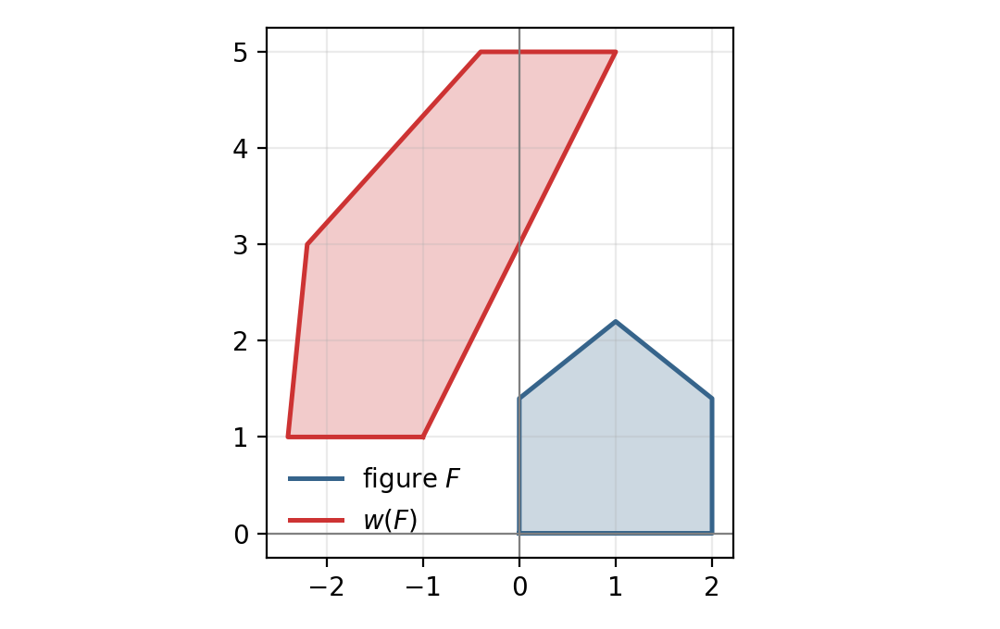

# Calculer les transformations avec Python {#annexe:python}

Cette annexe présente des programmes Python pour effectuer les calculs
du chapitre \ref{chap:transformations}. Ils permettent notamment de
résoudre les deux systèmes $3\times3$ du problème des deux triangles.
Nous utiliserons trois bibliothèques : `numpy` pour le calcul
numérique [@Harris2020]^[Disponible en ligne (libre accès) : <https://www.nature.com/articles/s41586-020-2649-2>.],
`sympy` pour le calcul exact [@Meurer2017]^[Disponible en ligne (libre accès) : <https://doi.org/10.7717/peerj-cs.103>.]
et `matplotlib` pour les figures [@Hunter2007]. La lecture
du chapitre ne demande pas d'utiliser ces programmes, mais ceux-ci
permettent de reprendre les exemples et d'en explorer d'autres.

### Représenter une figure et une transformation {.unnumbered}

Nous représenterons une figure par un tableau $2 \times n$ dont chaque
*colonne* contient les coordonnées d'un point, suivant une
convention courante en infographie. Cette disposition permet
d'appliquer la partie linéaire d'une transformation à tous les points
par un seul produit matriciel.

```{.python caption="Appliquer une transformation affine à un nuage de points."}
import numpy as np

def applique(A, t, pts):
    """A : matrice 2x2, t : vecteur (2,), pts : tableau 2 x n."""
    A = np.asarray(A, dtype=float)
    t = np.asarray(t, dtype=float).reshape(2, 1)
    return A @ np.asarray(pts, dtype=float) + t

# le rectangle [0,2] x [0,1], un sommet par colonne
rect = np.array([[0., 2., 2., 0.],
                 [0., 0., 1., 1.]])

A, t = [[1, -1], [2, 0]], [-1, 1]
print(applique(A, t, rect))
print("det =", np.linalg.det(A))
```

```{.python caption="Sortie du programme."}
[[-1.  1.  0. -2.]
 [ 1.  5.  5.  1.]]
det = 2.0000000000000004
```

Le calcul donne le parallélogramme de l'exemple \ref{ex:rectangle}.
Il faut cependant interpréter la valeur affichée pour le déterminant :
$2{,}0000000000000004$ plutôt que $2$. Cet écart vient de la
représentation des nombres en virgule flottante. Le calcul
*numérique* fournit en général des valeurs approchées, même
lorsque la réponse mathématique est un entier. Nous verrons plus loin
comment utiliser le calcul symbolique pour obtenir une réponse exacte.

### Une petite bibliothèque de transformations {.unnumbered}

```{.python caption="Les matrices du catalogue de la section \ref{sec:catalogue}."}
def rotation(theta):        # theta en radians
    c, s = np.cos(theta), np.sin(theta)
    return np.array([[c, -s], [s, c]])

def reflexion(theta):       # axe faisant l'angle theta avec Ox
    c, s = np.cos(2*theta), np.sin(2*theta)
    return np.array([[c, s], [s, -c]])

def homothetie(c):    return np.array([[c, 0.], [0., c]])
def cisaillement(m):  return np.array([[1., m], [0., 1.]])
```

### Composer : les coordonnées homogènes en pratique {.unnumbered}

Les coordonnées homogènes de la section \ref{sec:homogenes} permettent
de composer les transformations par des produits de matrices
$3\times3$. Reprenons la rotation $r$ et la translation $t$ de
l'exemple \ref{ex:homogenes-concret}. Le programme suivant calcule
les matrices $M_tM_r$ et $M_rM_t$, que nous avons déjà obtenues à
la main.

```{.python caption="Coordonnées homogènes : composer, c'est multiplier."}
def homogene(A, t):
    """Matrice 3x3 de w(X) = A X + t."""
    M = np.eye(3)
    M[:2, :2] = A
    M[:2, 2]  = t
    return M

def applique_h(M, pts):
    pts = np.asarray(pts, dtype=float)
    P = np.vstack([pts, np.ones(pts.shape[1])])
    return (M @ P)[:2]

M_rot  = homogene(rotation(np.pi/2), [0, 0])
M_tran = homogene(np.eye(2), [3, 1])

print(M_tran @ M_rot)   # d'abord la rotation, puis la translation
print(M_rot @ M_tran)   # l'ordre inverse
```

```{.python caption="Sortie : la composition n'est pas commutative."}
[[ 0. -1.  3.]        [[ 0. -1. -1.]
 [ 1.  0.  1.]         [ 1.  0.  3.]
 [ 0.  0.  1.]]        [ 0.  0.  1.]]
```

On constate que les deux matrices ont des parties translation
différentes. Le calcul illustre donc la remarque \ref{rem:inverse-composee}
et l'exemple \ref{ex:noncommutatif}. Pour en faire une activité
d'apprentissage, on peut demander aux élèves de *prévoir* les
deux résultats avant d'exécuter le programme, puis de comparer leur
prévision aux matrices obtenues.

### Résoudre le problème des deux triangles {.unnumbered}

Le programme suivant résout le système \eqref{eq:trois-points-systeme}
pour les données de l'exemple \ref{ex:deux-triangles}.

```{.python caption="L'unique application affine envoyant trois points sur trois points."}
def affine_par_trois_points(P, Q):
    """P, Q : listes de trois couples (x, y). Renvoie (A, t)."""
    M = np.array([[P[0][0], P[0][1], 1.],
                  [P[1][0], P[1][1], 1.],
                  [P[2][0], P[2][1], 1.]])
    if abs(np.linalg.det(M)) < 1e-12:
        raise ValueError("les trois points de depart sont alignes")
    abe = np.linalg.solve(M, [q[0] for q in Q])   # a, b, e
    cdf = np.linalg.solve(M, [q[1] for q in Q])   # c, d, f
    A = np.array([[abe[0], abe[1]], [cdf[0], cdf[1]]])
    t = np.array([abe[2], cdf[2]])
    return A, t

P = [(-11, 3), (1, 12), (-1, 14)]
Q = [(90, -68), (69, -53), (83, -59)]
A, t = affine_par_trois_points(P, Q)
print("A =", A.round(6).tolist())
print("t =", t.round(6).tolist())
```

```{.python caption="Sortie."}
A = [[-4.0, 3.0], [2.0, -1.0]]
t = [37.0, -43.0]
```

Le test portant sur le déterminant correspond à l'hypothèse de
non-alignement des trois points dans le théorème \ref{thm:trois-points}.
Il permet donc de vérifier que les données satisfont les conditions
d'application du résultat. Cet exemple illustre un intérêt de la
programmation en mathématiques : la rédaction du code amène à
expliciter les hypothèses et à décider comment traiter les cas où
elles ne sont pas satisfaites.

### Des réponses exactes avec `sympy` {.unnumbered}

Pour conserver une réponse exacte contenant des fractions ou des
expressions comme $\sqrt3/2$ et $\pi/4$, nous pouvons utiliser
`sympy`. Cette bibliothèque effectue des calculs symboliques,
sans remplacer systématiquement les nombres par des approximations
décimales.

```{.python caption="Le même problème, en calcul exact."}
import sympy as sp

a, b, c, d, e, f = sp.symbols('a b c d e f')
P = [(-11, 3), (1, 12), (-1, 14)]
Q = [(90, -68), (69, -53), (83, -59)]

eqs = []
for (x, y), (u, v) in zip(P, Q):
    eqs.append(sp.Eq(a*x + b*y + e, u))
    eqs.append(sp.Eq(c*x + d*y + f, v))

print(sp.solve(eqs, [a, b, c, d, e, f], dict=True)[0])
```

```{.python caption="Sortie : des entiers, pas des approximations."}
{a: -4, b: 3, c: 2, d: -1, e: 37, f: -43}
```

Le calcul symbolique permet aussi de vérifier des identités. Le code
suivant établit la relation $A^{\top}A = k^2 I$ pour la matrice d'une
similitude directe.

```{.python caption="Vérification symbolique de $A^{\top}A = k^2 I$."}
k, th = sp.symbols('k theta', positive=True)
S = k * sp.Matrix([[sp.cos(th), -sp.sin(th)],
                   [sp.sin(th),  sp.cos(th)]])
print(sp.simplify(S.T * S))     # Matrix([[k**2, 0], [0, k**2]])
print(sp.simplify(S.det()))     # k**2
```

### Reconnaître une similitude {.unnumbered}

Le critère $A^{\top}A = k^2 I$ permet d'écrire un programme qui
vérifie si une matrice représente une similitude.

```{.python caption="Est-ce une similitude ? Si oui, de quel rapport et de quel genre ?"}
def est_similitude(A, tol=1e-9):
    A = np.asarray(A, dtype=float)
    G = A.T @ A                     # doit valoir k^2 * I
    k2 = G[0, 0]
    if k2 <= tol:
        return (False, None, None)
    if np.linalg.norm(G - k2*np.eye(2)) > tol * max(1.0, k2):
        return (False, None, None)
    genre = "directe" if np.linalg.det(A) > 0 else "indirecte"
    return (True, float(np.sqrt(k2)), genre)

print(est_similitude([[0, -0.5], [0.5, 0]]))   # rotation + homothetie
print(est_similitude([[0.8, 0], [0.8, 0.6]]))  # exemple 1.9
print(est_similitude([[-4, 3], [2, -1]]))      # les deux triangles
```

```{.python caption="Sortie."}
(True, 0.5, 'directe')
(False, None, None)
(False, None, None)
```

Le deuxième appel retrouve le résultat de l'exemple \ref{ex:reconnaitre} :
aucune valeur du paramètre ne fait de la matrice
$\mat{0{,}8}{0}{a}{0{,}6}$ une similitude.

### Dessiner {.unnumbered}

Nous utiliserons enfin `matplotlib` pour représenter la figure
de départ et son image.

```{.python caption="Tracer une figure et son image."}
import matplotlib.pyplot as plt

maison = np.array([[0., 2., 2., 1., 0.],
                   [0., 0., 1.4, 2.2, 1.4]])
image = applique([[1, -1], [2, 0]], [-1, 1], maison)

fig, ax = plt.subplots(figsize=(5.4, 3.4))
for pts, coul, lab in [(maison, "#36648B", "figure $F$"),
                       (image,  "#CD3333", "$w(F)$")]:
    ferme = np.hstack([pts, pts[:, :1]])       # on referme le polygone
    ax.fill(ferme[0], ferme[1], color=coul, alpha=0.25)
    ax.plot(ferme[0], ferme[1], color=coul, lw=1.8, label=lab)

ax.set_aspect("equal")          # indispensable : sinon la figure ment
ax.grid(alpha=0.25)
ax.legend(frameon=False)
plt.show()
```

::: {#fig:py-polygone}
{width=82%}

Figure produite par le programme précédent. Le motif en forme de maison est déformé : les longueurs et les angles ne sont pas conservés, mais le parallélisme et l'alignement le sont, conformément à la proposition \ref{prop:proprietes}.
:::

::: {.remark #rem:aspect title="Le choix de l'échelle des axes"}
La commande `ax.set_aspect("equal")` impose une même échelle
sur les deux axes. Si on l'omet, `matplotlib` peut les ajuster
séparément pour remplir la fenêtre. Un cercle apparaît alors comme
une ellipse et un angle droit peut sembler ne plus l'être. On risque
ainsi d'attribuer à la transformation une déformation qui vient
uniquement de l'affichage. Cet exemple donne une occasion de discuter
en classe du rôle des échelles et de la nécessité d'interpréter les
réglages d'un outil graphique.
:::

### Reconnaître le genre et l'angle d'une similitude {.unnumbered}

Le programme suivant répond à la demande de l'exercice \ref{exo:python}. Il s'appuie
sur le fait qu'une matrice orthogonale $2\times2$ est nécessairement la
matrice d'une rotation ou d'une réflexion : une fois vérifié que
$A^{\top}A = k^2 I$, on pose $Q = A/k$ ; si $\dete(Q) > 0$, $Q$ est une
rotation d'angle $\theta = \operatorname{atan2}(Q_{21}, Q_{11})$, et sinon
une réflexion dont l'axe fait l'angle
$\tfrac12\operatorname{atan2}(Q_{21}, Q_{11})$ avec $Ox$, d'après
l'équation \eqref{eq:reflexion-theta}.

```{.python caption="Décomposer une similitude en rapport, angle et genre."}
import numpy as np

def decompose(A):
    A = np.asarray(A, dtype=float)
    k2 = (A.T @ A)[0, 0]
    if not np.allclose(A.T @ A, k2*np.eye(2)):
        raise ValueError("ce n'est pas une similitude")
    k = np.sqrt(k2)
    Q = A / k
    if np.linalg.det(Q) > 0:
        return k, np.arctan2(Q[1, 0], Q[0, 0]), "directe"
    return k, 0.5*np.arctan2(Q[1, 0], Q[0, 0]), "indirecte"
```

On peut vérifier le fonctionnement du programme avec les matrices de
la table \ref{tab:catalogue}, puis comparer les résultats aux
propriétés géométriques indiquées dans cette table.
