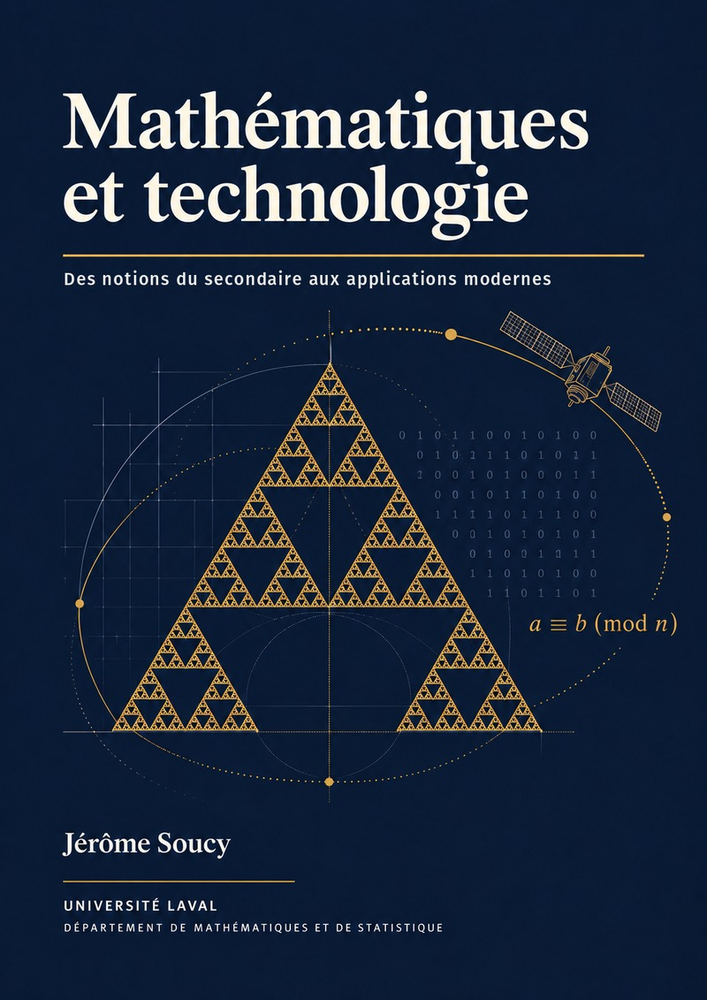

# Au sujet de ces notes {.unnumbered .avant-propos}

<!-- Couverture : version web seulement. Un clic télécharge le PDF, produit
     dans _book/ par « quarto render » (les deux formats à la fois). -->
::: {.content-visible when-format="html"}
```{=html}
<figure class="couverture">
  <a href="Math%C3%A9matiques-et-technologie.pdf" download
     title="Télécharger le livre en PDF">
    
  </a>
  <figcaption>Cliquez sur la couverture pour télécharger le livre en PDF.</figcaption>
</figure>
```
:::

::: {.credits}
Ces notes sont destinées aux étudiantes et étudiants du baccalauréat en
enseignement secondaire de l'Université Laval qui suivent le cours
*MAT-2901 : Mathématiques et technologie*. Dans cette perspective,
nous nous intéresserons aussi aux liens entre les notions étudiées et
les mathématiques enseignées dans les écoles secondaires québécoises.

\medskip

Les notes de Jean-Jacques Gervais [@Gervais2008], utilisées pendant
plusieurs années dans ce cours, ont servi de point de départ à une
partie de ce document. Le premier chapitre développe notamment le
contenu de leur annexe 1, consacrée aux transformations affines du
plan. Le troisième reprend des éléments de leur premier chapitre,
qui porte sur la construction de fractales.

\vfill

```{=html}
<div class="licence" style="display:flex; align-items:center; gap:1em; margin-top:1.5em; padding-top:1em; border-top:1px solid rgba(0,0,0,0.12);">
  <a href="https://creativecommons.org/licenses/by/4.0/deed.fr" rel="license"
     title="Licence Creative Commons Attribution 4.0 International" style="flex:none;">
    
    
  </a>
  <strong>Licence CC BY 4.0</strong>
</div>
```

```{=latex}
\noindent{\fontsize{26}{26}\selectfont\ccby}\quad
\raisebox{0.55em}{\textbf{Licence CC BY 4.0}}
\par\medskip
```

© 2026 Jérôme Soucy. Ce document est mis à disposition selon les termes de
la licence [Creative Commons Attribution 4.0
International](https://creativecommons.org/licenses/by/4.0/deed.fr)
(CC BY 4.0). Vous êtes libre de le copier, de le redistribuer, de le
modifier et de l'adapter, pour tout usage, à condition de citer
l'auteur, d'indiquer si des modifications ont été apportées et de
fournir un lien vers la licence. Les programmes qui l'accompagnent
(code Python, filtres et application interactive) sont distribués sous
la licence MIT. Les portraits et les jeux de données conservent leur
licence d'origine ; leur source est indiquée dans leur légende ou à leur
première utilisation.

Pour citer ce document : Jérôme Soucy, *Mathématiques et technologie :
des notions du secondaire aux applications modernes*, 2026.
:::
